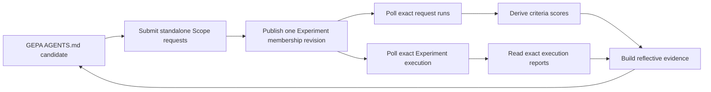

# GEPA × Scope Optimizer (`apps/gepa-optimizer`)

Optimizes an **`AGENTS.md`** file with the [GEPA](https://github.com/gepa-ai/gepa)
reflective prompt-optimization algorithm, where every candidate is scored by a
**real Scope benchmark run** — the Copilot CLI worker (Linux) with the
**Claude Haiku 4.5** model.

This mirrors the reference experiment (`geo-experiments/gepa-prompt-optimization`)
but, instead of optimizing a system prompt evaluated by a single LLM completion,
it optimizes an `AGENTS.md` evaluated by a multi-turn Scope agent run and judged
against a criteria DAG.



One optimization owns one canonical Scope Experiment. By default the entry
point creates an empty Experiment, then every `evaluate()` call adds its newly
submitted requests through `POST /experiments/:id/requests`. That publishes a
new immutable revision and execution, whose exact identities and reports are
stored in the GEPA outputs and reflective trajectories. Set
`SCOPE_EXPERIMENT_ID` to target an existing Experiment instead.

## Polyglot exception

This is a **Python** app (managed by [`uv`](https://docs.astral.sh/uv/)) living in
a TypeScript/pnpm monorepo, exactly like the Rust `apps/gateway`. It is
intentionally **outside** the pnpm workspace. `uv.lock` is committed and CI runs
`uv sync --locked && uv run pytest`. Root scripts: `pnpm test:gepa`,
`pnpm build:gepa`.

## Setup

```bash
cd apps/gepa-optimizer
uv sync                 # create .venv and install deps from uv.lock
cp .env.example .env    # then edit SCOPE_API_URL, SCOPE_PROJECT_ID, criteria ids, reflection LM creds
```

## How scoring works

The GEPA score is **derived, never persisted in Scope**. For a finished run:

- The **denominator is the number of requested criteria** (not whatever Scope
  returned), so a missing/skipped criterion always counts as failed.
- A criterion only counts as passed when it was **evaluated and passed**;
  `evaluated == false` (skipped because a DAG ancestor failed) counts as failed.
- Per-turn score = `passed / requested`. The run score aggregates turns via
  `SCOPE_SCORE_STRATEGY`:
  - `mean` (default) — average across all turns;
  - `final` — last turn only (closest to "task success");
  - `weighted` — `0.8 * final + 0.2 * mean`.
- A run that did not succeed, has no turns, or errored scores `0.0` (never `NaN`).

## Budget

GEPA counts **one metric call per dataset example**, and each metric call is a
full (minutes-long) Scope agent run. Rough spend per optimization:

```text
len(valset)                      # seed validation
+ 2 * reflection_minibatch_size  # parent + child minibatch per proposal
+ len(valset)                    # full re-validation of each accepted candidate
```

Keep `valset` tiny and `GEPA_MAX_METRIC_CALLS` small.

## Run

Edit `src/gepa_optimizer/dataset.py` so the criterion ids exist in your Scope
instance (`pnpm cli criteria list`), then:

```bash
uv run gepa-optimizer
# or
uv run python -m gepa_optimizer.main
```

Results (best candidate, Pareto front, and a best-effort lineage DAG
reconstructed from GEPA's parent indices) are written to `runs/<timestamp>/results.json`.
The artifact also records the canonical `experimentId` and final
`experimentRevisionId`. Every evaluated request remains visible in the normal
Scope Runs, Experiment Detail, CLI, and API surfaces.

## Tests

```bash
uv run pytest            # or, from repo root: pnpm test:gepa
```

Unit tests cover scoring, reflective-dataset construction, lineage
reconstruction, the REST client (via `httpx.MockTransport`), and the adapter
(with a stubbed client). No live Scope instance is required.

## Concurrency

`SCOPE_MAX_CONCURRENCY` (default **10**) caps in-flight runs to match the Linux
`coder-acp-copilot` KEDA ceiling (`maxReplicaCount: 10`). Submitting more is
harmless — extras just queue — but yields no speedup.

## Lineage

Parent→child lineage is reconstructed **after** optimization from GEPA's public
`result.parents` / `result.candidates` and saved into `results.json`
(`root` / `mutation` / `merge`). Candidate evaluation requests are grouped by
canonical Experiment membership revisions rather than a caller-provided
correlation field.
