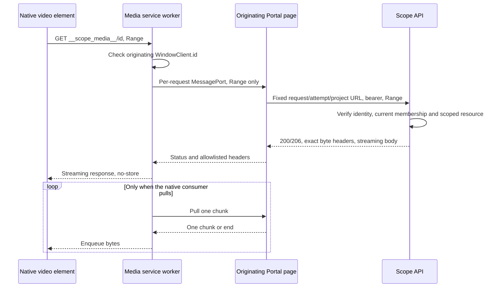

# Authenticated progressive recordings

`VideoPlayer` never assigns a protected API or stored blob URL directly to a
native `<video>` element. Browser media requests cannot use the Portal's bearer
injection hook. Fetching the whole recording into a blob would authenticate it,
but sacrifice progressive loading and seeking.

A narrowly routed, same-origin service worker bridges native media requests to
the originating page. The page fetches each range through `fetchArtifact` and
the existing `apiClient`. It does not acquire its own tokens or introduce signed
URLs, cookie sessions, public blobs or an authentication exception. The bridge
uses the API's current authentication and project-membership policy.

## Request and trust boundaries



The page fixes the project, request/attempt and setup/iteration/index selectors
when opening the bridge. The worker can request a range, not another upstream
URL. The random bridge ID is routing, not a bearer capability: fetches must have
the same nonempty client ID as the opening same-origin, in-scope WindowClient.
Other tabs, frames and clientless navigations fail closed.

Tokens remain in the existing page transport. The worker receives no token,
user profile or protected URL. Neither bridge writes protected bytes or handles
to CacheStorage, IndexedDB or local storage. Every new range goes through the
normal API authentication and project-scoped resource lookup. With authentication
enabled, removing membership prevents the next authorized range. An already
authorized range may finish until its session is canceled; bytes already buffered
in the browser cannot be clawed back. See [Authentication & RBAC](auth-rbac.md)
for the canonical authority and explicit authentication opt-out contract.

## Byte delivery and failures

Current and historical video routes stream Azure blob bodies rather than buffer
recordings. Explicit, open-ended and suffix ranges return `206` with exact
`Content-Range`, `Content-Length` and `Accept-Ranges: bytes`. Ends beyond the
recording are clamped. Invalid, multi-range or unsatisfiable requests return
`416` with `Content-Range: bytes */size` without downloading a blob. Selectors
must be unambiguous nonnegative integer indexes, positive integer iterations or
`phase=setup`. Missing recordings return `404`.

The page validates progressive headers and the exact requested interval. The
worker enforces message order and declared body length, rejecting malformed,
unsolicited, oversized or truncated chunks. It forwards only delivery headers
and forces `Cache-Control: no-store`. Errors retain their HTTP status; `416`
retains range metadata. Errors display as text with **Retry recording**, not as
media or a saved JSON file.

Each native pull permits one `reader.read()` and one chunk round trip; the
worker's zero-high-water-mark stream keeps `pull()` pending until that round trip
finishes. This serializes queued native demand without requiring transferable
streams. Cancellation, errors and timeouts settle pending pulls. The shared
HTTP response hook can introduce bounded transport prefetch, and browser/network
buffering is outside this protocol; neither bridge eagerly drains a recording.

Transient establishment retries belong to `fetchArtifact`; a single `401`
refresh belongs to `apiClient`. The bridge adds no retry loop. Body failures
never restart bytes silently. Permanent `403`/`404` errors do not request login.
Worker/protocol timeouts abort the page fetch.

## Lifecycle and browser support

The shared artifact session supplies project/account/resource identity and
cancellation. `VideoPlayer` pauses and clears the native source on session
cancellation and suppresses late URL publication. Unmount, retry, identity
changes and logout close ports, cancel readers and abort fetches. `pagehide`
closes bridges; idle sessions expire after five minutes. Worker control and
bridge opening each have ten-second bounds. Range headers and chunk pulls have
thirty-second deadlines, with at most four concurrent ranges per bridge.

Seeking cancels its old range without closing the recording session. Controller
changes fail visibly and require reopening. Browsers may terminate idle workers
before the application timeout: worker state is not durable. A missing session
after restart is denied, not restored as a capability.

Support requires HTTPS (or trustworthy localhost), service workers,
MessageChannel, streaming responses, `AbortSignal.any` and `crypto.randomUUID`.
Unsupported browsers and CSP/registration failures display errors; there is no
whole-file fallback. Incompatible active, waiting or installing registrations
are not replaced or unregistered. Storybook's root MSW worker is deliberately
incompatible; stories exercise conflict/retry UI, not simulated playback.

## Deployment

The shipped root-hosted nginx configuration serves the actual
`/scope-media-worker.js` JavaScript asset with no-store/nosniff and no SPA
fallback. Uncontrolled `/__scope_media__/...` routes return no-store `403`.
Same-origin API responses have proxy buffering/cache disabled.
Changes to `public/` require rebuilding a deployed Portal image; a TypeScript
hot reload alone cannot update a copied asset.

The client derives script, scope and bridge URLs from Vite `BASE_URL`; the worker
uses its registration scope. A prefix deployment must configure Vite's base,
serve the real prefixed worker asset, deny prefixed uncontrolled bridge paths
and keep artifact API URLs same-origin. A unit test is not proof of a prefixed
reverse-proxy deployment.

CSP must allow `worker-src 'self'`, `media-src 'self'` and `connect-src 'self'`
alongside existing IdP connections. No `blob:` media permission, wildcard source,
broad worker scope or bearer in a URL is needed. Unrelated routes are not
intercepted.

## Validation and acceptance

Focused checks from the repository root:

```bash
pnpm exec vitest run apps/portal/src/lib/authenticated-media.test.ts apps/portal/src/components/VideoPlayer.test.tsx apps/portal/src/components/VideoPlayer.play.test.tsx apps/api/src/routes/requests/video.test.ts --reporter=default
pnpm --filter shared build
pnpm --filter telemetry build
pnpm --filter api build
pnpm --filter portal build
pnpm --filter portal build-storybook
pnpm notice:check
```

The bridge suite executes the deployed JavaScript using native MessageChannels,
Request/Response and ReadableStream, the real page bridge and bearer transport.
API tests include a real test-server connection closed during an unfinished
blob range. Player tests cover lifecycle, stale identities and StrictMode;
composed stories cover conflict/retry and no-project states. These are
protocol/component checks, not native browser playback evidence.

Artifact cancellation stories keep responses pending until their request is
aborted, rather than racing a fixed response delay. Their Vitest harness checks
the request abort and absence of download dispatch, stubs native anchor
navigation and restores the document URL between cases so authorization stories
cannot inherit a blob URL from an earlier download.

Real-browser acceptance must run on this implementation with isolated fixtures
and the existing login flow, not use a combined RBAC branch as proof. Verify
actual archive bytes; advancing playback before a throttled upstream transfer
finishes; seeking beyond buffered bytes with a new exact range; current,
setup, iteration/index and historical recordings; cancellation on
account/project/attempt change, logout and navigation; permanent `401`,
`403`, `404`, `416` and interrupted bodies; other-client denial, worker restart,
no protected persistent cache and no token-bearing URLs. Record browser/version
and distinguish generated fixtures from worker-produced recordings. Delivery
checks require no new benchmark, worker, scheduler or external deployment.

Historical acceptance on a combined branch does not establish this extracted
layer's browser acceptance, other browser engines, prefix deployments or
worker-side recording/upload.

### Delivery-only extracted-layer acceptance

The delivery-only implementation was exercised in Chromium 156.0.8078.12 against
the actual Vite Portal and built API, with separate MongoDB, Redis, Azurite and
Entra Local fixtures. Login used the real MSAL redirect and existing Scope-user
enrollment, without RBAC changes or mocked authentication. Recordings were
generated fixtures, not worker output; no benchmark or worker was executed.

The actual archive download contained the exact nested snapshot proof bytes.
With the browser throttled to 250,000 bytes/s, a 13,611,229-byte, 90-second WebM
advanced through 20 native frames after only 201,447 upstream bytes. Seeking
beyond the buffered interval to 70 seconds requested `bytes=10059776-`,
resumed at 70.2148 seconds and canceled two obsolete transfers. Setup,
iteration and explicitly historical recording metadata also loaded.

Stored logs isolated current and historical attempts, and live SSE rendered a
synthetic Redis event through completion. Project replacement invalidated the
old bridge; sign-out followed by a different account created a new bridge and
denied the old one. Entra Local required manually returning to the Portal after
its signed-out page. A second browser client was denied an active bridge.
An injected first-range `401` recovered through the existing MSAL refresh
transport; an injected `403` displayed a visible error without a playable source.
The real API separately returned `401` for an invalid bearer, `403` for a
disabled fixture identity and `416` with the exact recording length for an
unsatisfiable range. CacheStorage remained empty.

This does not establish production-nginx, prefix-hosted, Safari or Firefox
acceptance, worker restart/idle-expiry recovery, real-worker capture/upload or
every interrupted-body and delayed-history browser case. Protocol, component
and API tests cover additional failure/lifecycle cases; they are not substitutes
for those remaining native-browser/deployment checks. The delivery-only checks
retained the previous no-token rollout; they do not establish cumulative RBAC
acceptance or weaken the authentication-enabled policy described above.
