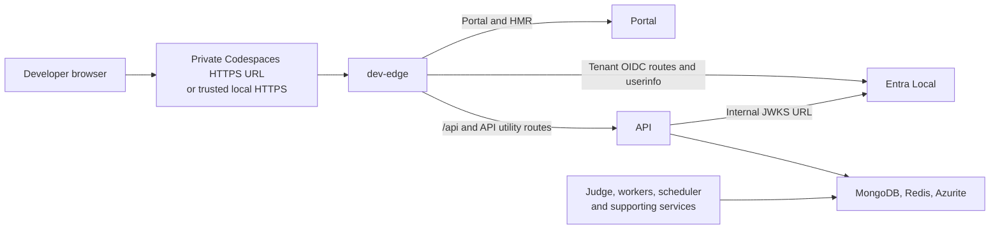

# Devcontainer and Kind implementation plan

> Status: **Proposed; not implemented.** This plan covers local VS Code Dev
> Containers and GitHub Codespaces. It does not claim the proposed topology has
> passed an end-to-end Codespaces test.

## Recommendation

Use one Linux devcontainer with a dedicated Docker-in-Docker daemon and two
execution modes:

- **Fast development:** infrastructure in Docker Compose; selected applications
  run as debuggable processes in the devcontainer.
- **Kubernetes development:** the full Linux application stack and infrastructure
  run in Kind, with real Kubernetes ServiceAccounts, source synchronization,
  and debugger attachment from the same devcontainer.

Use a **single private browser-facing origin** for the Portal, API, and Entra
Local sign-in endpoints. Keep browser URLs, token issuers, and internal service
addresses explicit and separate. Codespaces still uses ordinary ports internally;
its HTTPS forwarding URL is the external entry point, not a replacement for
container or Kubernetes networking.

**Platform boundary:** the Windows Copilot worker cannot execute in a Linux
devcontainer or a Linux Kind cluster. Its TypeScript can be edited and built
there, but Windows execution and debugging require a separate Windows host.
Include that workflow rather than silently excluding the worker or promising
Windows containers in Codespaces.

## Existing foundations and gaps

| Area | Current repository state | Planned treatment |
|---|---|---|
| Toolchain | pnpm workspaces; Node services; Rust gateway; Python prompt evaluations; separate Astro website | Include every development toolchain, not just Node |
| Infrastructure | `docker-compose.yml` defines MongoDB, Redis, Azurite, Lowkey Vault, Entra Local, and initialization services | Reuse images and initialization contracts |
| Development loop | `docker-compose.dev.yml` and `scripts/dev-entrypoint.sh` support source watching | Preserve existing Compose workflows; share debugger and environment handling |
| Debugging | `.vscode/launch.json` attaches only to the Docker API; the shared entrypoint already accepts `NODE_INSPECT_PORT` | Extend coverage to every executable and execution mode |
| Authentication | Entra Local advertises configurable origins; the API supports separate issuer and JWKS settings | Configure public identity URLs independently of internal key retrieval |
| Browser access | Vite proxies `/api` and API utility routes; emulator redirect registration hardcodes `http://localhost:<PORTAL_PORT>` | Add a development edge and exact origin-based registration |
| Kubernetes | `.k3d/config.yaml`, build/down scripts, and a partial Bake inventory exist; `scripts/k3d-up.sh` and application Kubernetes manifests are absent | Implement Kind explicitly; do not treat the k3d scaffold as a working deployment |
| Runtime inventory | Scheduler, post-processor, report-generator, scanners, and utilities extend beyond the older architecture overview | Derive coverage from checked-in packages and Dockerfiles |

Relevant implementation sources are
[`docker-compose.yml`](../../docker-compose.yml),
[`docker-compose.dev.yml`](../../docker-compose.dev.yml),
[`authConfig.ts`](../../apps/portal/src/lib/auth/authConfig.ts),
[`vite.config.ts`](../../apps/portal/vite.config.ts),
[`dev-entrypoint.sh`](../../scripts/dev-entrypoint.sh), and
[`pnpm-workspace.yaml`](../../pnpm-workspace.yaml).
Preserve the contracts in [Authentication & RBAC](auth-rbac.md),
[real-time data flow](../research/realtime-data-flow.md), and
[Kubedock](kubedock.md).

## 1. Devcontainer foundation

Add `.devcontainer/devcontainer.json`, a Dockerfile, and small lifecycle scripts.
Use a non-root development user and a pinned Debian/Ubuntu-based image.

### Tooling and resources

Install Node versions matching the service images, pnpm from the root
`packageManager`, Rust with rustfmt/Clippy/cargo-watch and LLDB, Python 3.11+ with
uv, Git, GitHub CLI, Docker Engine/Compose/Buildx, Kind, kubectl with Kustomize,
Helm, Skaffold, Azure CLI, PowerShell, jq, curl, OpenSSL, and mkcert. Pin versions and
download checksums where supported; do not use floating `latest` downloads.
Keep Node 22/24 selectable for the existing runtime split instead of changing
all service images as part of this work.

Provide Chromium and its Linux dependencies for existing Playwright workflows.
Install browser binaries using each consuming package's locked Playwright
version. Include the gateway's native compilation dependencies. Keep the
agents' Go, .NET, Java, Maven, Gradle, and other task toolchains in the existing
worker images; those images remain the execution environment for benchmark
tasks rather than requiring every agent dependency in the editor container.

Recommend an initial **4-core/16-GB fast-mode** and **8-core/32-GB full-Kind**
machine, with at least **80 GB available disk** for the latter. These are sizing
targets to measure, not verified minimums. Bound concurrent image builds and
worker concurrency; record cold-build and steady-state measurements before
publishing final requirements. Include local Docker Desktop resource settings.

### Docker and lifecycle

Use the maintained Docker-in-Docker devcontainer feature, not the host Docker
socket. Its privileged outer container is an explicit prerequisite. This avoids
host/remote bind-mount path mismatches and makes Kind's published loopback ports
reachable from the editor container. It is **not** a security sandbox for
untrusted agents: use disposable environments without sensitive host mounts.

Persist Docker state, pnpm/Cargo caches, and development data in
devcontainer-scoped volumes. Do not share caches across incompatible CPU
architectures. Keep the workspace writable by the development user.

Lifecycle responsibilities:

1. **Image build/prebuild:** install pinned tools; never enroll users, seed
   personal credentials, run paid models, or bake in a Codespaces URL.
2. **Create/update:** install locked dependencies, build shared packages in
   dependency order, prepare the separate website install and Python environment,
   and generate non-secret workspace configuration.
3. **Start:** verify Docker readiness, resolve current origins, validate existing
   state, and restore only an explicitly selected development mode.
4. **Attach:** report status and the correct browser URL; do not repeat migrations
   or start duplicate watchers.

Provide `doctor`, `up`, `down`, `logs`, and explicit `reset-data` operations.
Normal stop/rebuild must preserve databases and credentials. Destructive reset
must target only this workspace's named resources and require confirmation.

## 2. Browser access and authentication

### One external origin, separate internal addresses

Use a small development-only reverse proxy, such as nginx, named **dev-edge**
to distinguish it from the existing Rust AI gateway.

The browser uses one origin; server-to-server traffic stays on private networks.

In fast mode, run dev-edge in the devcontainer network namespace so it can reach
native processes and loopback-published infrastructure. In Kind mode, run it
inside the cluster and expose only its Service through a loopback-bound Kind
port mapping. Use the same route template with mode-specific upstreams.

Generate separate native, Compose, and Kind connection settings. Native
processes use loopback-published infrastructure; Compose services use service
DNS; pods use Kubernetes Service DNS. In fast mode, keep full benchmark workers
in their toolchain-equipped containers and provide explicit routes back to any
native Judge/API/token-manager processes through Docker's host gateway.
Bind those native listeners only as broadly as the isolated Docker bridge
requires, without publishing them to the local host or Codespaces browser.
Do not assume `localhost` inside a worker means the devcontainer.

Define `PUBLIC_ORIGIN` as:

| Environment | Browser-facing origin | Edge transport |
|---|---|---|
| Codespaces | `https://${CODESPACE_NAME}-${EDGE_PORT}.${GITHUB_CODESPACES_PORT_FORWARDING_DOMAIN}` | HTTP inside the codespace; GitHub terminates external HTTPS |
| Local Dev Containers | `https://localhost:${EDGE_TLS_PORT}` | HTTPS with a trusted development certificate |

Use environment-specific listeners, for example 8080 for Codespaces and 8443
for local HTTPS. Forward only the selected entry point for normal use.
Require the local forwarded port to equal the advertised port; fail clearly on
conflicts instead of letting VS Code silently select a different callback
origin. Provide an explicit override for parallel local devcontainers.
Retain worktree offsets for existing Compose workflows.

Codespaces origins must be generated at startup from the documented environment
variables, with an explicit origin override for other remote environments.
Validate scheme, hostname, and port; do not derive trusted issuer configuration
from arbitrary inbound `Host` or `X-Forwarded-Host` headers.

### Routing contract

Route `/api/*`, `/openapi.json`, `/api-docs`, `/health`, `/ready`, and `/about`
to the API, preserving the existing Portal proxy behavior. Route the configured
tenant's OIDC paths, and supported aliases where needed, to Entra Local:

- `/<tenant>/v2.0/.well-known/openid-configuration`
- `/<tenant>/discovery/v2.0/keys`
- `/<tenant>/oauth2/v2.0/*`
- `/graph/oidc/userinfo`

Send remaining Portal paths and its HMR WebSocket to Vite. Match complete path
segments and give auth/API routes precedence over the SPA fallback.
Do **not** invent an `/auth` prefix and assume the emulator supports base-path
rewriting. Its pinned source uses tenant-root routes and sign-in forms posting
back to the authorize endpoint.

Keep Entra's admin API and credential-management surfaces off the browser edge;
bootstrap them over the internal network. Do not send unknown `/graph` or
tenant-auth paths to the Portal as successful HTML responses.

Configure WebSocket upgrades, SSE without response buffering, suitable idle
timeouts, upload limits, and exact Vite allowed hosts. Use `wss` and external
port 443 for Codespaces HMR when explicit HMR configuration is necessary.
Never use `allowedHosts: true` or wildcard CORS as a connectivity workaround.
Verify all browser-visible artifact/download URLs use reachable routes rather
than Docker DNS names or Azurite loopback URLs.

### Authentication configuration

For public origin `P` and configured tenant `T`:

| Setting | Value/contract |
|---|---|
| Entra `PUBLIC_ORIGIN` | `P`; collapse advertised login/graph origins onto it |
| Entra `ISSUER` | `P/T/v2.0` |
| Portal `VITE_AUTH_AUTHORITY` | `P/T/v2.0` |
| Portal `VITE_AUTH_KNOWN_AUTHORITIES` | Exact external host, including a non-default local port |
| Portal redirect and post-logout URI | Exact `P`, matching the application's current origin-based callback |
| API `AUTH_AUTHORITY` | `P/T` |
| API `AUTH_ISSUER_TEMPLATE` | `P/{tenantid}/v2.0` |
| API `AUTH_JWKS_URI` | Internal Entra endpoint, e.g. `https://entra-local:8443/T/discovery/v2.0/keys` in Compose |
| Client IDs, audience, scopes | Consistent seeded SPA/API registrations; keep protocol mode `OIDC` |

Replace the localhost-only redirect initializer with an idempotent initializer
using the resolved exact SPA URL. Verify logout allowlisting against the pinned
emulator. Register no wildcard callbacks. Restart Vite after origin changes;
production-style Portal images need those public settings supplied at build
time, not merely as nginx container environment variables.

The API fetches keys internally but validates the **external issuer**, including
the selected JWK's issuer metadata. Preserve signature, audience, expiry, tenant,
and key-issuer checks. The currently pinned Entra Local `v0.1.1` source publishes
`issuer` on each JWK; validate the actual image before selecting its digest.
The older compatibility warning in `ENV_VARIABLES.md` is not proof that this
image is incompatible.

Preserve unchanged IdP bearers and the existing handshake:
fresh login calls `POST /users/me`; cached-account reload calls `GET /users/me`.
Do not introduce a synthetic dev principal, bypass token verification, or turn
off Portal auth to make Codespaces work.

### TLS and private port access

Local mkcert installation **inside the container does not trust certificates
on the developer's browser host**. Document a one-time host-side trust step
using only the public CA certificate. Never transfer the CA private key.
Keep API-to-emulator TLS verification enabled with a separate public-CA mount.
Issue certificates for actual internal DNS names used by Compose/Kind clients.
Configure Lowkey Vault trust independently as well; do not propagate the
existing token-manager Compose TLS-verification bypass into the new stack.

In Codespaces, the browser trusts GitHub's certificate, not a localhost mkcert
certificate. Match the forwarding protocol to the HTTP edge listener; external
HTTPS does not imply that the internal listener must also speak HTTPS.

Keep the forwarded port **private to its owner**. Separate forwarded hosts can
introduce cross-origin requests and GitHub forwarding-auth redirects before an
OIDC request reaches the emulator. A single origin avoids that dependency:
the user authenticates to the forwarded application once by top-level browser
navigation, then MSAL and Portal requests remain same-origin.

Never inject `GITHUB_TOKEN` into the browser or use a public emulator port as a
fallback. Internal CLI/API/JWKS traffic bypasses the forwarding layer. An
external REST client needs forwarding-layer authentication separately from its
unchanged Scope IdP bearer; document that as an advanced workflow.

## 3. Complete runtime coverage

Maintain one reviewed runtime inventory for bootstrap, build targets, debugging,
and documentation. Do not interpret every package as a long-running server.

| Category | Required coverage |
|---|---|
| Backing services | MongoDB, Redis, Azurite blobs/queues/tables, Lowkey Vault, Entra Local |
| Initialization | Certificates, Mongo replica-set initialization, migrations, storage containers, exact redirect registration, agents and versions |
| Long-running applications | API, Portal, Judge, token-manager, scheduler, Rust gateway |
| Workers | Linux Copilot and Claude Code, report-generator, post-processor |
| Existing worker sidecars | Preserve enabled proxy/backend and MCP-gateway dependencies from Compose; do not add a new integration architecture |
| One-shot/scheduled utilities | Copilot/Anthropic model scanners, checked-in version checkers, GitHub cookie updater |
| Developer tools | CLI, migrations, Vitest, Storybook, static prompt evaluations, separate Astro website |
| Libraries | All workspace dependencies built/watched in dependency order; debug through consuming programs and tests |
| Windows worker | Separate Windows execution target, image build, and tunneled Node attachment |

Use a **single-node MongoDB replica set** in the new development environments so
change-stream-dependent behavior can actually be exercised. Native clients
need a reachable replica-set member address or a deliberate single-node
`directConnection=true` configuration; do not advertise Docker-only hostnames
to native processes.

Keep infrastructure credential-free where emulators support it. Real Copilot,
Anthropic, and Azure inference still require appropriate user credentials and
entitlements. A Codespaces repository token is not automatically a usable
Copilot/provider credential. Use Codespaces secrets or ignored `.env.local`,
pass each secret only to its consumers, and report unavailable live-provider
features explicitly. Never place secrets in image layers, frontend settings,
generated public configuration, or prebuild logs.

Do not run paid benchmarks, model scans, or account maintenance automatically
on container creation. Provide explicit commands/jobs for them.

## 4. Kind deployment and ServiceAccounts

Add `.devcontainer/kind/cluster.yaml` and a self-contained local Kustomize base
with fast/debug overlays. Keep existing k3d commands unchanged until a separate
deprecation decision; do not repurpose their names to launch Kind.

Start with one pinned Kind control-plane node to limit resource usage. Keep the
Kubernetes API on devcontainer loopback and use an explicitly scoped kubeconfig
and context in every command. Do not modify a developer's default cluster
context or forward the Kubernetes API through Codespaces.

Map dev-edge's NodePort through Kind `extraPortMappings`, with matching node
container port and Service `nodePort`, and `listenAddress: 127.0.0.1`. The
forwarded Codespaces port is the resulting devcontainer-side host port.

Run all Linux services and emulators in the cluster, not just the API/Portal.
Use Deployments/Services for daemons, Jobs for initialization and one-shot
tools, and CronJobs only for explicitly enabled scheduled utilities.
Implement readiness/startup probes and bounded readiness waits; apply order
alone does not guarantee migrations, registration, or dependencies are ready.
Provide on-demand Kind targets for the CLI, tests/evaluations, Storybook,
website, and cookie updater too; they need not all run continuously. Missing
images or deployment targets are implementation work, not implicit exclusions.

Extend the incomplete `docker-bake.hcl` inventory or use a shared build
inventory to cover every required image. Reuse existing Dockerfile dev stages;
add missing utility/dev targets only where necessary. Build locally and use
`kind load docker-image --name <workspace-cluster>` with unique image tags and
appropriate pull policies. A registry, ACR, Flux, KEDA, External Secrets, and
Azure operators must not be prerequisites for local startup.

Persist emulator data using PVCs backed by a workspace-scoped persistent volume
mounted through Kind `extraMounts`; Kind-node deletion alone must not silently
delete it. Keep agent workspaces separate from repository source and state.
Document backup/reset semantics and an explicit clean-cluster rebuild path.

### Kubernetes identity

Assign named ServiceAccounts to workloads. Disable automatic API token mounts
for services that do not need Kubernetes access. Grant namespace-scoped Roles
and RoleBindings only for actual operations, never blanket `cluster-admin`.

For Kubernetes-API-consuming workloads, use projected, short-lived ServiceAccount tokens
with an explicit intended audience. Exercise in-cluster API discovery, CA trust,
token rotation, namespace identity, and both allowed/denied RBAC operations.
Application-specific token audiences must be tested against their intended
verifier, not assumed to be Kubernetes API audiences.

Keep the developer's privileged kubeconfig out of application and agent pods.
Kind ServiceAccounts are real Kubernetes identities but do **not** automatically
provide Entra Workload Identity or access to Azure; federation remains a
separate future integration.

For workers needing Docker-compatible task execution, implement the documented
Kubedock sidecar pattern with narrowly scoped RBAC. The documentation describes
a Kustomize component that is not present here: this plan must supply it.
Do not mount the outer devcontainer's Docker socket or Kind-node runtime socket
into worker pods. Pin an architecture-compatible Kubedock image and test the
actual supported Docker operations; do not claim complete Docker API parity.

### Edit/build/debug loop

Add a focused Skaffold development configuration for Kind, using existing dev
images, file synchronization, and rebuild rules. Sync application and workspace
dependency source; rebuild on lockfile, manifest, Dockerfile, and toolchain
changes. Do not sync host `node_modules` into Linux images.

Ensure shared-library changes become visible to running services, not merely
compiled into `dist`. Preserve worker cancellation/graceful-stop semantics and
avoid simultaneous watcher processes restarting a worker during a run.
Use one replica for a debug-selected service and exclude paid/unattended work.
Skaffold is a proposed new tool here; pin it and validate its integration before
making the workflow the default.

## 5. Debugging every project

Extend `.vscode/launch.json` and `tasks.json` without removing the current API
configuration. Debug adapters run in the devcontainer; inspector ports are not
browser-facing endpoints.

| Target | Debugging contract |
|---|---|
| Node services/workers | Native launch and attach; per-process inspector ports; Compose loopback mappings; Kind pod port-forwards; source maps and restart/reconnect |
| CLI, migrations, scanners, version checkers, cookie updater | Argument-aware launch profiles; `--inspect-brk` for short-lived programs so startup breakpoints are reliable |
| TypeScript libraries/tests | Debug their test runner or consuming service with workspace source mapping |
| Portal, Storybook, website | Browser-side JavaScript/TypeScript breakpoints and HMR; Node debug profile for Astro server/build code where applicable |
| Rust gateway | CodeLLDB/Cargo debug build natively; LLDB remote attachment in a dedicated debug image/pod |
| Python evaluations | Python/debugpy launch profiles with the evaluation virtual environment; no automatic cloud execution |
| Windows worker | Windows host runtime plus private SSH/tunnel attachment and `C:/app` source mapping; Windows CI remains required |

Reuse `NODE_INSPECT_PORT` per service; do not globally set inspector
`NODE_OPTIONS`, which can collide in inherited worker subprocesses.
Map `/app` back to the workspace and use the gateway's actual build path for
Rust source mapping. Provide compounds for core services and selected workers.

Supervise Kind debugger port-forwards and restart them when the target pod is
replaced. Keep inspector/LLDB/debugpy ports loopback-only, without public
Services, Ingress, or Codespaces forwarding. Limit ptrace permissions and any
relaxed seccomp setting to explicit Rust debug targets.

Do not promise that Codespaces' browser editor can attach to the user's local
browser process. Provide an in-container Chromium debug target, with a private
desktop/noVNC route when interactive UI is required, for browser-editor users.
Provide a local Chrome/Edge launch option when using desktop VS Code.
Both paths must support real frontend source breakpoints, not just API debugging.

Document that pausing queue workers can expire leases, trigger timeouts, or
activate the scheduler's stuck-run recovery. Use isolated debug runs and explicit
development timeout/concurrency settings; do not change production defaults.

## 6. Implementation sequence and deliverables

| Phase | Deliverables | Exit criterion |
|---|---|---|
| 1. Feasibility spike | Minimal DinD/Kind boot; dev-edge plus existing Entra image and Portal/API; resource/architecture inventory | Real local and private-Codespaces PKCE login works; Kind API is reachable internally; Windows exception documented |
| 2. Reproducible environment | Devcontainer image/config, lifecycle scripts, tool pins, caches, `doctor`, origin/config resolver | Clean clone opens locally and in Codespaces without machine-specific paths or embedded secrets |
| 3. Fast development | Complete infra bootstrap, native service tasks, shared watchers, exact redirect setup, private edge | Portal/API/CLI and a selected worker operate through resolved endpoints; legacy Compose workflows still work |
| 4. Kind stack | Kustomize resources, initialization Jobs, all image targets, persisted state, ServiceAccounts/RBAC, Kubedock | Full Linux stack operates inside Kind with no host Docker socket in pods and no required Azure control-plane services |
| 5. Debugging and iteration | Node/Rust/Python/browser profiles, Skaffold sync/rebuild, supervised tunnels, compounds | Breakpoint hit and resume demonstrated for every runtime category; source edits and pod replacement recover correctly |
| 6. Automation and documentation | Focused tests, CI smoke workflow, onboarding/troubleshooting, measured sizing | Acceptance matrix below passes with live-provider checks clearly separated from credential-free checks |

Phase 1 precedes broad implementation: validate the risky auth/networking
assumptions before building an entire dev environment around them. Phase 4
depends on the environment and configuration contracts from phases 2-3.
Runtime-specific debugger work can proceed alongside deployment work once
source paths and port allocation are fixed.

Proposed command surface: `pnpm dev:doctor`, `pnpm dev:up --mode=native`,
`pnpm dev:up --mode=kind`, `pnpm dev:down`, and
`pnpm dev:debug --service=<name>`. These names are proposals, **not existing
commands**. The orchestration must select exactly one active mode per workspace
unless separate state/ports are explicitly configured; do not start duplicate
consumers against the same queues.

Put generated non-secret runtime files in an ignored development directory.
Preserve `.env.local` as user-managed input and generated `.env` as the existing
worktree tool's output. Define and test precedence rather than letting shell,
Compose, Vite, and Kubernetes each resolve settings differently.

Update `CONTRIBUTING.md`, `ENV_VARIABLES.md`, this document, relevant auth and
Kubedock documentation, and the public website's contributor guidance when the
implementation lands. Register any new website page in its sidebar. Update
dependency notices through the repository's notice tooling when adding tools or
dependencies that require attribution.

## 7. Acceptance matrix

Test clean create, stop/start, rebuild, and teardown in local Linux Docker,
Docker Desktop on macOS/Windows with Linux containers, and real Codespaces.
Validate arm64 image availability and native compilation separately; explicitly
report any amd64 emulation requirement rather than assuming every image is
multi-architecture.

| Requirement | Required evidence |
|---|---|
| Reproducible setup | Locked installation succeeds from a clean clone; doctor identifies missing Docker privileges, insufficient resources, port collisions, and unavailable provider credentials |
| Codespaces auth | New browser session opens one owner-private URL; discovery, PKCE sign-in, token acquisition/refresh, API enrollment, cached reload, logout, and re-login succeed without public ports |
| Identity correctness | Discovery issuer, token `iss`, selected JWK issuer, audience, and callback URI agree; invalid signatures/audiences/issuers and unknown callbacks remain rejected |
| Local TLS | Sign-in works in a real host browser after trusting only the public dev CA; untrusted or wrong-host internal certificates fail |
| Proxy correctness | No internal names/ports leak into browser requests; API errors remain errors; deep links, HMR WebSockets, uploads, downloads, SSE events, and completion survive the proxy |
| Stack completeness | Every inventory entry has a runnable service/job/task; migrations, registration, blobs, queues, Lowkey Vault access, and Mongo change streams work |
| Live execution | With explicitly supplied credentials, each Linux coder completes a small run through Judge, post-processing, reports, and streamed logs; missing credentials are not counted as success |
| Debugging | Hit source breakpoints in each Node entrypoint and representative shared code, frontend targets, Rust, and Python; verify resume and reattachment after source restart/pod replacement |
| Kubernetes identity | A pod uses its own projected token/CA; an allowed operation succeeds, a denied operation fails, rotation is observed, and no developer kubeconfig is mounted |
| Worker container operations | Representative Kubedock build/run/exec/cleanup works within the permitted namespace without access to outer Docker or unrelated workloads |
| State and isolation | Rebuild preserves expected emulator state; explicit reset clears only selected workspace resources; separate devcontainers do not share queues or credentials |
| Platform limits | Windows image/runtime validation runs on Windows; local arm64 limitations and browser-editor debugger workflow are documented and demonstrated |

Automate configuration precedence, URL generation, proxy route coverage,
redirect-registration idempotency, and bootstrap failure handling using the
existing test framework. Add a credential-free devcontainer/Kind CI smoke
workflow and keep paid/provider tests opt-in for trusted execution.
A localhost browser test does **not** substitute for the private Codespaces
forwarding/authentication test. Record the tested image digests, resource
measurements, and debugger matrix before marking implementation complete.

## Reference material

The URL and forwarding design follows GitHub's
[Codespaces environment variables](https://docs.github.com/en/codespaces/developing-in-a-codespace/default-environment-variables-for-your-codespace)
and [port-forwarding documentation](https://docs.github.com/en/codespaces/developing-in-a-codespace/forwarding-ports-in-your-codespace).
The Docker topology uses the maintained
[Docker-in-Docker feature](https://github.com/devcontainers/features/tree/main/src/docker-in-docker);
Kind networking and mounts follow its
[configuration reference](https://kind.sigs.k8s.io/docs/user/configuration/).

The proposed same-origin routing is grounded in Entra Local `v0.1.1`'s
[path map](https://github.com/cmaneu/entra-local/blob/v0.1.1/src/http/pathmap.ts),
[metadata generation](https://github.com/cmaneu/entra-local/blob/v0.1.1/src/identity/metadata.ts),
and [JWK issuer publication](https://github.com/cmaneu/entra-local/blob/v0.1.1/src/tokens/jwks.ts).
Source inspection establishes feasibility, not end-to-end validation.
