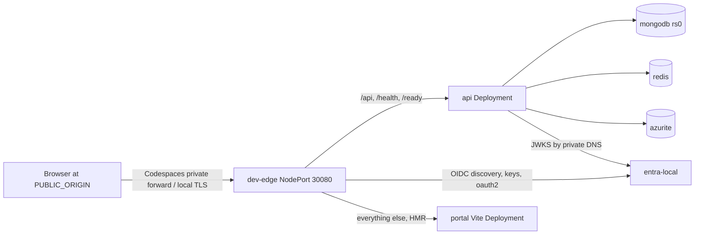

# Devcontainer and Kind feasibility spike

Status: **experimental**. The auth spike (phase one) and a working Kind mode
(`pnpm dev:up --mode=kind`, phase four core) exist and have been exercised end to
end in Codespaces (see [Kind mode](#kind-mode) and the
[evidence ledger](#evidence-ledger)). Real browser sign-in through the
owner-private Codespaces forward works; a local-browser login (host certificate
trust) has not been checked yet. The existing Compose and worktree-offset
workflows are unchanged.

## Prerequisites and isolation

The maintained Docker-in-Docker feature requires a **privileged outer container**.
The editor uses its own Docker daemon and persistent, devcontainer-scoped Docker
and containerd volumes, not a mounted host socket. This is **not a security
sandbox** for untrusted benchmark tasks. Use a disposable machine without
sensitive host mounts. Worker task toolchains still belong in worker images.

The spike uses Node 22.22.0, pnpm from the root `packageManager`, Kind 0.27.0,
kubectl 1.32.2, Compose 2.35.1, Buildx 0.22.0, Docker Engine 29.3.0, and the locked
DinD 4.1.3 feature. Release binaries use published checksums. Base/emulator/edge
and Kind node images are digest-pinned. Debian packages are **not snapshot-pinned**;
this is not the final reproducible toolchain. Node 24 selection, Rust, Python/uv,
browsers, Azure/PowerShell, and the remaining phase-two tools are still pending.

Codespaces requests 8 CPUs, 32 GB RAM, and 64 GB storage through
`.devcontainer/devcontainer.json` for the full Kind workload. This is a minimum
machine specification, subject to the machine types allowed by the organization.
For fast mode on Docker Desktop, configure at least 4 CPUs / 16 GB RAM and
sufficient disk capacity under Settings -> Resources (or the WSL2 resource
configuration on Windows). The spike bounds Compose concurrency at two; it does
not start any workers. Full-stack build and worker concurrency limits and
cold/steady-state measurements remain required. arm64 and Windows/macOS have not
been validated; do not assume that all images run natively on arm64. Windows
worker execution and image validation remain separate Windows targets, not
Linux/Kind capabilities.

## Run the probe

Reopen the workspace in its devcontainer. Creation installs only locked root
dependencies. Attach prints guidance; it does not enroll users, migrate data,
run providers, restore a mode, or start watchers. The complete create/start/
attach lifecycle is phase-two work. No secrets or forwarding URLs are image
inputs. The experimental pnpm cache is devcontainer-scoped; do not reuse these
volumes between CPU architectures.

```bash
pnpm dev:spike doctor
pnpm dev:spike config
pnpm dev:spike up
pnpm dev:spike probe
pnpm dev:spike logs
pnpm dev:spike down
```

`doctor` reports tools, daemon availability, resources, and whether provider
credential variables are present, never their values. Presence does not prove
entitlement. It does not yet implement the complete resource/port/provider
acceptance checks. `config` generates ignored non-secret files under
`.dev-state/spike`. This spike uses **process environment > built-in defaults**;
it deliberately does not read or modify `.env.local` or worktree-generated
`.env`. A shared native/Compose/Kind precedence resolver is still required.

Inputs: `PUBLIC_ORIGIN`, `AUTH_TENANT_ID` (UUID), `EDGE_PORT` (Codespaces,
default 8080), `EDGE_TLS_PORT` (local, default 8443), and `SPIKE_ENTRA_PORT`
(internal loopback TLS, default 18443). Non-default local ports must be forwarded
unchanged. Stop, regenerate settings, and restart edge **and Vite** when the origin
changes. Startup rejects stale generated edge settings and occupied ports.

Codespaces resolves `https://${CODESPACE_NAME}-${EDGE_PORT}.${GITHUB_CODESPACES_PORT_FORWARDING_DOMAIN}`
at runtime, or uses an explicit `PUBLIC_ORIGIN` override for another remote
environment. Local origin defaults to `https://localhost:${EDGE_TLS_PORT}`.
Neither request `Host` nor forwarded headers establish trusted issuer settings.

Only forward the selected edge port. In Codespaces, keep it **private to its
owner**, with forwarding protocol **HTTP**, even though the external URL is
HTTPS. The configuration disables automatic forwarding. Authenticate to the
forwarded application with a top-level browser navigation. Never make Entra's
port public or inject a repository token into the browser. External REST clients
need forwarding-layer authentication separately from their unchanged IdP bearer;
internal CLI/API/JWKS requests must bypass that layer.

The probe starts **only Entra Local and dev-edge**, plus certificate staging.
It registers the exact current origin on the seeded SPA app via the loopback
admin endpoint. Only 201/already-present 409 succeed; bounded transient retries
and five-second request timeouts apply. It checks discovery URLs, every JWK's
external issuer, nginx discovery proxying, and denied admin/unknown-auth routes.
It does not perform interactive enrollment, logout, or model calls.

The edge runs in the editor network namespace, with native upstream slots
`localhost:3100` (API) and `localhost:5100` (Vite). **Those applications and their
infrastructure are not provisioned by this spike.** Portal/API routes return
502 until the applications run; this is not a usable full-stack browser URL yet.
API and auth routes precede SPA fallback; streaming and WebSocket upgrades are
configured. Full HMR/upload/download/SSE/artifact verification remains pending.

The generated `public.json` records external issuer/authority/redirect settings
and the native JWKS URL. It contains no credentials. It is not automatically
loaded into API/Vite. Compose and Kind settings must later use their own private
DNS JWKS addresses while preserving the external issuer and unchanged bearer
validation, including selected-key issuer checks. Exact Vite allowed hosts and
Codespaces `wss`/443 HMR configuration remain integration work.

## TLS and state

mkcert generates the CA in `.dev-state/spike/authority`, outside mounted leaf
certificates. **Never transfer `rootCA-key.pem`**. Only leaf certificates/keys and
the public `rootCA.pem` enter the certificate volume; clients receive public CA
material. The nginx, Node, and curl probes keep TLS verification enabled.
Generated state and certificates are excluded from image build contexts.

For a real local-host browser test, copy **only**
`.dev-state/spike/certs/rootCA.pem` to the host and import it into that host's
trusted root certificate store (and Firefox's store if separate). On Linux,
use the distribution's public-root installation procedure; macOS uses the System
Keychain; Windows uses Trusted Root Certification Authorities. Container-side
`mkcert -install` cannot establish host-browser trust. Remove the public root
from the host when retiring the environment. Codespaces browsers instead trust
GitHub's external certificate. Lowkey Vault trust is not configured in this spike;
its later integration must not reuse a TLS-verification bypass.

Normal `down`, container stop, and rebuild preserve emulator data in the scoped
Docker volume. CA files remain in the ignored workspace directory. Back up these
separately before deleting the workspace or outer Docker volumes. Destructive
reset requires the exact project name printed by `doctor`:

```bash
pnpm dev:spike reset-data --confirm=scope-spike-<workspace-hash>
```

This deletes only that Compose project's emulator/certificate volumes, including
registrations and signing keys, not other projects or the CA directory. It does
not remove a Kind cluster. Failed startup leaves state for diagnosis; use `logs`
and `down`, not global Docker prune/reset commands.

## Kind mode

Kind mode runs the backing services, the selected applications, and the dev edge
inside a single-node Kind cluster created in the devcontainer's own Docker daemon.
Stop native mode or the auth spike first (`pnpm dev:down`); both use the edge port.

```bash
pnpm dev:up --mode=kind --services=api,portal --build   # first run: builds and loads images
pnpm dev:up --mode=kind --services=api,portal           # later runs: reuse loaded images
pnpm dev:logs --service=api                             # last 100 lines of any Deployment or Job (portal, mongodb, db-migrate…)
pnpm dev:debug --mode=kind --service=api                # inspector on 127.0.0.1:9230
pnpm dev:job --service=tests                            # run a suspended one-shot Job
pnpm dev:smoke --mode=kind                              # credential-free up -> checks -> down
pnpm dev:down                                           # deletes only this workspace's cluster
```

When `--build` is used, startup checks available disk space and warns if less
than 10 GiB is free; the warning does not block the build. The devcontainer
configuration forwards port `8080` automatically, so Codespaces users do not
need to add a port mapping manually.

In Kind mode, `pnpm dev:logs` reads the logs of the named Deployment or Job with
`kubectl logs` instead of native log files. To follow logs live or inspect pods,
point kubectl at the workspace kubeconfig (`dev:up` never writes the default one):
`KUBECONFIG=.dev-state/runtime/kubeconfig kubectl -n scope-dev logs -f deployment/api`.

The browser reaches the stack through one origin. The node maps NodePort 30080
to loopback `EDGE_PORT`, and the in-cluster nginx edge routes by path.



How `dev:up --mode=kind` proceeds ([cluster.ts](../../scripts/dev/cluster.ts)):

1. Mint edge/Entra leaf certificates (via the spike) and the separate Lowkey Vault PKI.
2. Create (or reuse) cluster `scope-dev-<workspace-hash>` with its own kubeconfig in
   `.dev-state/runtime/kubeconfig`; the default kubeconfig is never touched.
3. Build (`--build`) and `kind load` `scope-local/<name>:<project>` images. App images
   use each Dockerfile's `dev` target; Portal and one-shot tools share
   [runtime.Dockerfile](../../.devcontainer/runtime.Dockerfile).
4. Render the stack ([kind.ts](../../scripts/dev/kind.ts)) into
   `.dev-state/runtime/kustomize`, upload certificates as a Secret/ConfigMap, and apply.
5. Run the suspended init Jobs in order: `mongo-init` → `storage-init` →
   `redirect-init` → `db-migrate`; then scale the selected Deployments to one replica
   and run `register-agents` when the API is selected.

Rendering rules that matter when you change the stack:

- **Every workload has its own ServiceAccount** with `automountServiceAccountToken: false`.
  No runtime socket, developer kubeconfig, or privileged identity is mounted.
- **Every Job renders `suspend: true`**; the lifecycle unsuspends init Jobs, and
  utilities (model scanners, version checkers, cookie updater) only run via `dev:job`.
  Workers render with zero replicas; do not start them without intending to spend credits.
- **Deployments carry a `scope.dev/config-hash` annotation** for the ConfigMaps they
  consume (`scope-runtime`, `dev-edge`). A changed origin or setting rolls exactly those
  pods; ConfigMap edits alone never restart pods or reload nginx.
- **Edge `proxy_set_header` directives live at server level only.** nginx drops all
  inherited headers in a location that declares any of its own. A per-location
  header once dropped the public `Host`, and Vite rejected the request as `Host: portal`.
- The init script for `mongo-init` is run with `mongosh --eval`, which rejects `await`
  inside loop bodies; it pauses with mongosh's synchronous `sleep()`.
- [.devcontainer/kind/base](../../.devcontainer/kind/base) is a committed render of the
  defaults; CI fails on drift. Regenerate with
  `pnpm exec tsx scripts/dev/kind.ts .devcontainer/kind/base --defaults`.

State persists across `dev:down`/cluster recreation: PersistentVolumes use
`Retain` hostPaths under `SCOPE_DEV_DATA` (a devcontainer-scoped volume) mounted
into the node at `/scope-state`.

### Debugging in Kind

`dev:debug --mode=kind --service=<name>` patches the Deployment to
`node --inspect-brk=0.0.0.0:<port>` (dropping `--watch` and probes), port-forwards
the inspector to **loopback only**, and restores the original command and probes
on exit. Attach with the **Scope: Attach Kind Node (Private Tunnel)** launch
configuration, which maps `/app` to the workspace. Inspector ports are listed in
[inventory.ts](../../scripts/dev/inventory.ts). tsx emits some modules on a single
generated line, so set breakpoints through VS Code (source-mapped), not with raw
CDP line numbers.

### Kubedock and task identities

Set `SCOPE_DEV_KUBEDOCK=true` before `dev:up` to add the
[kubedock component](../../.devcontainer/kind/components/kubedock): a sidecar on the
coding-agent workers with a short-lived projected token, and a namespace-scoped
Role in `scope-dev-tasks` (baseline Pod Security). The worker identities can manage
pods only in `scope-dev-tasks`, cannot create pods in `scope-dev`, and cannot read
secrets. Task pods run as `kubedock-task` with no token. See
[kubedock.md](kubedock.md) for the production equivalent.

### Spike-only Kind boot

`pnpm dev:spike kind-up` / `kind-down` still create a bare node with no manifests,
using `.dev-state/spike/kubeconfig`. It is kept only for topology probes.

## Runtime inventory and remaining sequence

The inventory in [inventory.ts](../../scripts/dev/inventory.ts) drives native launch,
image builds, Kind rendering, and debugger ports. "Rendered" means a workload and
identity exist in the Kind stack. "Verified" means it ran in the evidence ledger.

| Category | Required targets | Kind mode coverage |
| --- | --- | --- |
| Backing services | Replica-set MongoDB, Redis, all Azurite APIs, Lowkey Vault, Entra Local | All rendered and verified ready |
| Initialization | Certificates, replica set, migrations, blobs/queues, redirects, agents/versions | All verified as Jobs |
| Applications | API, Portal, Judge, token-manager, scheduler, Rust gateway | All rendered; API and Portal verified |
| Workers | Copilot, Claude Code, report-generator, post-processor; existing enabled proxy/MCP sidecars | Rendered at zero replicas; Kubedock RBAC verified; not started (paid) |
| Utilities | Copilot/Anthropic scanners, checked-in version checkers, cookie updater | Rendered as suspended Jobs (`dev:job`); not run |
| Developer tools | CLI, migrations, Vitest, Storybook, prompt evals, separate Astro install, Python environment | Migrations verified; others rendered as suspended Jobs |
| Libraries | Workspace dependencies built/watched in dependency order | Built in the tools/app images; no in-cluster watch of packages |
| Windows | Separate image/runtime, private tunnel, `C:/app` mapping, Windows CI | Existing Windows exception preserved |

Remaining work, in order:

1. **Local-browser login:** repeat the browser sign-in in a local devcontainer, with the
   public dev CA imported into the host trust store.
2. Start and verify judge, token-manager, scheduler and gateway in Kind; run one
   opt-in, trusted worker end to end (consumes credits).
3. Validate Skaffold sync/rebuild ([skaffold.yaml](../../.devcontainer/skaffold.yaml)),
   HMR over the Codespaces `wss`/443 forward, SSE, and downloads.
4. Reduce the 6.5 GB tools image (it dominates `kind load` time) and pin Debian packages.
5. Credential-free Kind smoke in CI, arm64/Docker Desktop validation, and the full
   acceptance matrix.

## Evidence ledger

Observed on 2026-11-02, Linux amd64 Codespaces host, 8 CPUs, 31.3 GiB RAM,
49 GiB initially free disk (below the full-Kind target):

| Check | Result |
| --- | --- |
| Origin, routing, retries, workspace names and metadata unit tests | 58 passed |
| Base spike image and maintained DinD feature | Built; privileged container started with CLI 0.90.0 |
| Dockerfile checks / isolated Compose configuration | Passed |
| DinD Entra + nginx HTTP and HTTPS probes | Passed with verified internal CA |
| Redirect repeated probe and stop/start | Passed without removing data volumes |
| Wrong-host TLS certificate | Rejected by curl with exit 60 |
| Kind internal `/readyz` with scoped kubeconfig | Passed; node readiness reported 17 seconds, not total cold-start time |
| Idle auth-only snapshot | Entra 51.15 MiB / 9.90% CPU; edge 8.434 MiB / 0.00% CPU; not a sustained/full-stack measurement |
| Real PKCE/refresh/logout, Portal POST enrollment/GET reload | Not run in the spike; see the Kind-mode browser sign-in below |
| Private forwarding, host-browser trust, HMR/SSE/downloads, provider/platform acceptance | **Not run** |

Kind mode, observed on 2026-11-03, Linux amd64 Codespaces host, 16 CPUs,
62 GiB RAM, 100 GiB free disk:

| Check | Result |
| --- | --- |
| `scripts/dev` unit tests / tooling typecheck / committed manifest drift | 77 passed / passed / in sync |
| `dev:up --mode=kind --services=api,portal --build` | Passed after fixing the `mongo-init` script; `api` image 862 MB, `tools` image 6.47 GB |
| Init Jobs (`mongo-init`, `storage-init`, `redirect-init`, `db-migrate`, `register-agents`) | All completed; `mongo-init` rerun is idempotent |
| Edge routes on `127.0.0.1:8080` | `/`, `/runs`, `/@vite/client`, `/health`, `/ready`, OIDC discovery and keys 200; `/admin/*` 404 |
| Invalid IdP bearer on `/api/v1/users/me` | 401 `invalid_token` |
| Discovery issuer | External Codespaces origin, not an internal hostname |
| `dev:debug --mode=kind --service=api` | Paused at entry; source breakpoint in the `/ready` handler hit via an edge request; Deployment restored on exit |
| Workload identities | `api` runs as SA `api`, no token mounted, cannot list pods |
| Kubedock component RBAC | Worker SAs: create pods in `scope-dev-tasks` yes, in `scope-dev` no, secrets no; `api` SA no |
| `dev:smoke --mode=kind` (cached images, new cluster, up → checks → down) | Passed in 332 s; cluster deleted |
| Real browser sign-in via the owner-private Codespaces forward (2026-11-05, manual) | Works; signed in to the Portal through the edge |
| Local-browser sign-in with host-trusted dev CA | **Not run** |
| Judge/token-manager/scheduler/gateway, workers, Skaffold, data persistence across cluster recreation | **Not run** |

Immutable references used:

- Node 22.22.0 bookworm: `sha256:20a424ecd1d2064a44e12fe287bf3dae443aab31dc5e0c0cb6c74bef9c78911c`
- Entra Local 0.1.1: `sha256:70584ef110914d100409cb3d63a63548ccdde10ca780f9751755f1482dec5d7e`
- nginx 1.28.2 alpine: `sha256:5b4900b042ccfa8b0a73df622c3a60f2322faeb2be800cbee5aa7b44d241649e`
- Kind node 1.32.2: `sha256:142f543559cc55d64e1ab9341df08e5ced84bd2e893736da8f51320f26f5950b`
- DinD 4.1.3: feature digest/integrity in `.devcontainer/devcontainer-lock.json`.

No live-provider entitlement, sustained resource load, arm64, Docker Desktop, or
Windows success is implied.