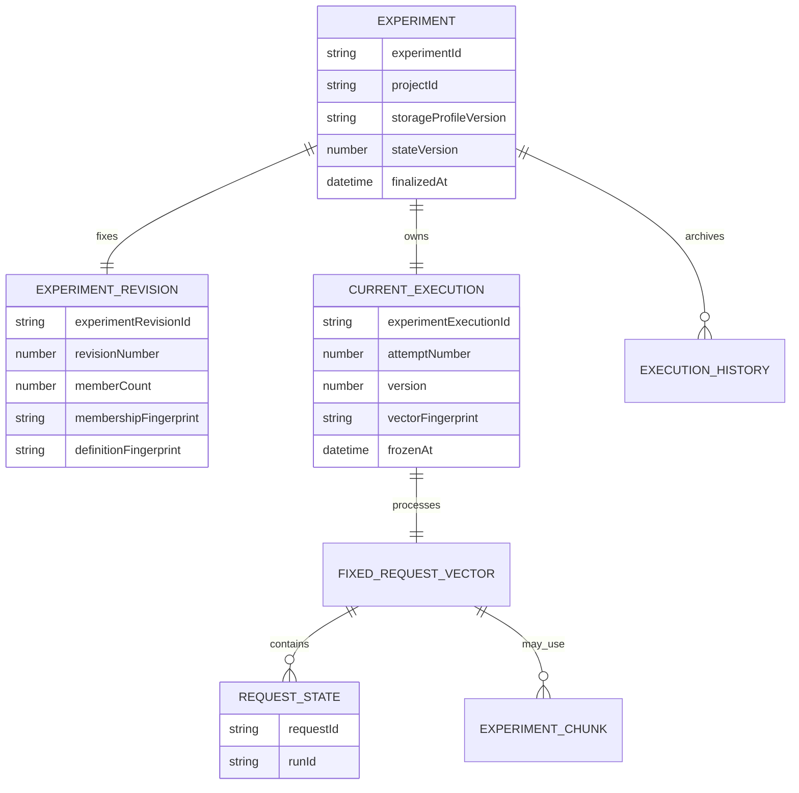
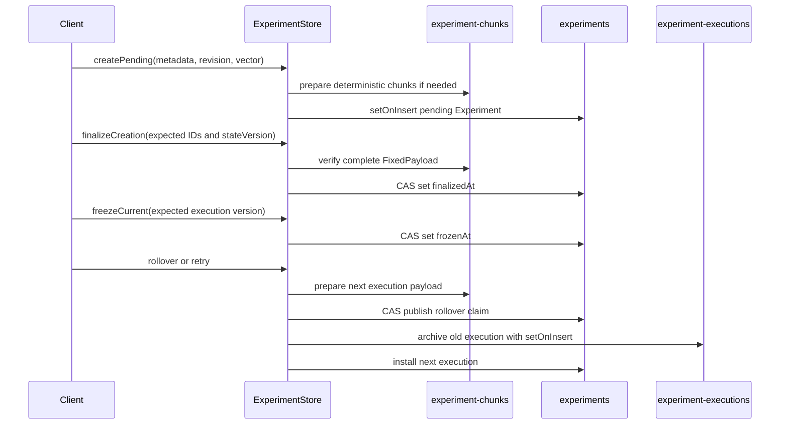

# Experiments Architecture

> **Status:** PR A foundation and client contract, current as of October 2026.

Experiments are project-scoped, named benchmark compositions. An Experiment
stores durable metadata, one immutable revision, and one current processing
execution. Previous executions are immutable history records.

PR A provides the canonical storage model, project-scoped public API contract,
CLI commands, Portal creation/list/detail flows, and run correlation. It does
not add mutable membership or cascading lifecycle behavior.

## Model



### Revision versus execution

An **Experiment revision** describes the composition itself:

- `experimentRevisionId` and sequential `revisionNumber`;
- exact `memberCount`;
- `membershipFingerprint` for the member set;
- `definitionFingerprint` for the complete definition;
- immutable creation time.

An **Experiment execution** is one processing attempt over that revision:

- `experimentExecutionId` and sequential `attemptNumber`;
- optimistic-concurrency `version`;
- the exact request/run vector and its `vectorFingerprint`;
- handler status, blockers, and processing timestamps;
- freeze, discard, and supersession state.

Retry creates a new execution attempt over the same stored request vector. It
does not create a new revision or retry member runs. Revision membership
mutation is deferred to PR C.

### Exact request/run vector

Each `ExperimentRequestState` is a bounded, nonrecursive leaf containing the
exact `requestId`, exact `runId`, dependency projections, and blockers captured
for that member. Request IDs are unique within the vector. Each dependency and
blocker list is bounded to 32 entries, and each serialized request state is
limited to 4 KiB.

The exact `{requestId, runId}` identity vector is immutable after publication
and covered by `vectorFingerprint`. Dependency projections and blockers are
mutable bounded state covered by the `FixedPayload` descriptor's
`payloadFingerprint`. Reads reconstruct the original position order and reject
missing positions, duplicates, count mismatches, identity mismatches, or
fingerprint mismatches.

## FixedPayload storage

`FixedPayload<T>` has two representations:

| Representation | Stored on the execution | Use |
| --- | --- | --- |
| `inline` | `entryCount`, `payloadFingerprint`, and `entries[]` | The complete Experiment document fits the operational target |
| `chunked` | `entryCount`, `payloadFingerprint`, assignment version, `bucketCount`, and deterministic `chunkIds[]` | The inline document exceeds the operational target |

The storage profile is versioned as `cosmos-mongo-2mb-v1`.

- **2 MiB hard ceiling:** no selected Experiment or chunk document may exceed
  `maxDocumentBytes`.
- **256 KiB operational target:** inline storage is used only when the complete
  Experiment document is at or below `targetDocumentBytes`.
- Chunk selection reserves 16 KiB for metadata and applies an 80% load factor
  to the remaining target.
- Empty vectors are always inline.
- The bucket search is bounded to 65,536 buckets and fails explicitly when no
  safe layout exists.

### Deterministic routing and chunk identity

Chunk routing is versioned as `sha256-mod-v1`. For a chosen bucket count, the
store hashes:

```text
"experiment-request-bucket:v1\0" + requestId
```

The full SHA-256 digest is interpreted as an unsigned big-endian integer, then
reduced modulo `bucketCount`. This makes assignment independent of input order
and stable across processes.

Chunk IDs are also deterministic. The store serializes this canonical tuple:

```text
["sha256-v1", projectId, experimentId, kind, ownerId, generation, chunkIndex]
```

It hashes the JSON bytes with SHA-256, encodes the digest as base64url, and
prefixes it with `ec_v1_`. `ownerId` is the execution ID and `generation` is
the attempt number. Upserts use `$setOnInsert`; a read-back comparison rejects
an existing deterministic ID whose identity or contents differ.

## Publication and concurrency

Experiment creation and execution rollover use a prepare-then-publish protocol.



### Compare-and-swap rules

- `stateVersion` protects whole-document publication transitions.
- `execution.version` protects handler claims/completions, freeze, discard, and
  rollover.
- Handler writes require the expected execution ID and version, the expected
  handler version/status, and an unfrozen execution with no rollover claim.
- Freeze competes through the same execution-version compare-and-swap. A
  writer/freezer race has one winner.
- Rollover requires the current execution to be frozen and records an embedded
  claim containing the complete next execution before replacing the current
  pointer.

### Finalization, archive, and repair

`createPending()` may prepare chunks before the root document exists.
`finalizeCreation()` verifies the complete payload and atomically sets
`finalizedAt`. Public `get` and `list` operations return only finalized
Experiments, so partially published state is never visible.

Before rollover, the current execution is frozen. Archival writes an immutable
history document keyed by `experimentExecutionId` with `$setOnInsert`, then
reads it back and requires exact equality. The history record includes the
revision and supersession metadata.

The rollover claim is the repair journal. `repairRollover()` verifies the next
payload, idempotently archives the old execution, and installs the claimed next
execution. A caller can resume this sequence after interruption without
inventing state. Prepared chunks that were never published can be removed with
`discardUnpublished()`.

## Collection and index ownership

| Collection | Owner and contents | Indexes created by migration 034 |
| --- | --- | --- |
| `experiments` | One finalized/current document per Experiment; `_id` equals `experimentId` | `{ projectId: 1, _id: 1 }` for project-scoped paging and lookup |
| `experiment-executions` | Immutable archived execution history; `_id` equals `experimentExecutionId` | `{ projectId: 1 }`; `{ experimentId: 1, attemptNumber: -1 }` |
| `experiment-chunks` | Deterministic immutable request-vector chunks | No secondary index; chunks are addressed directly by deterministic `_id` |

The `ExperimentStore` owns root and history writes. `FixedPayloadStore` owns
chunk preparation, read verification, and unpublished cleanup. Migration
`034-create-experiment-storage-indexes.ts` owns the secondary indexes and
intentionally leaves removal to a manual operation in `down()`.

Every lookup includes `projectId` in addition to the entity ID. An Experiment
ID is never resolved globally.

## Runtime ownership

The API owns `ExperimentCoordinator`, including authoritative run projection,
readiness, rollover, retry, publication repair, and Experiment-handler
dispatch policy. Its polling loop repairs missed notifications, vector drift,
dropped queue notices, and interrupted publication or rollover.

The scheduler continues to own coding-agent and per-run handler dispatch. For
Experiment handlers it only applies exact claim and completion messages
through shared `ExperimentStore` compare-and-swap primitives. Storage layout,
routing, fingerprinting, and state transitions remain reusable typed modules
under `packages/shared/src/experiments`; they do not own workflow policy.

## Public API

All routes require `?projectId=`:

| Method | Route | Behavior |
| --- | --- | --- |
| `POST` | `/api/v1/experiments` | Create from `{ mode: "compose", metadata, requests }` or `{ mode: "empty", metadata, requests: [] }` |
| `GET` | `/api/v1/experiments` | Cursor-page finalized Experiments |
| `GET` | `/api/v1/experiments/:id` | Read the public Experiment and current execution |
| `GET` | `/api/v1/experiments/:id/executions` | List current and archived execution summaries |
| `GET` | `/api/v1/experiments/:id/executions/:experimentExecutionId` | Read one exact current or archived execution |
| `POST` | `/api/v1/experiments/:id/retry` | Start a new processing attempt for the current exact vector |

Creation metadata requires `name` and accepts an optional `description`.
Compose mode requires one or more complete request definitions and empty mode
requires an empty request array.

The public view exposes identity, project, metadata, revision, current
execution, readiness, blockers, handler progress, supersession, current report,
and linked request summaries when available. Creation additionally returns
`requestIds`. List responses and execution-list responses use
`{ data, nextCursor? }`.

## CLI and Portal

The CLI provides:

```text
scope experiment create
scope experiment list
scope experiment get <experiment-id>
scope experiment executions <experiment-id> [experiment-execution-id]
scope experiment retry <experiment-id> --execution <current-execution-id>
```

Creation reuses run configuration flags, adds Experiment metadata, supports
composition preview, and supports explicit empty creation. Every command
requires project scope.

The Portal provides `/experiments`, `/experiments/new`, and
`/experiments/:id`. The shared creation form retains the established run
configuration and expansion count and adds Experiment metadata. No selected
scenario creates an empty Experiment; selecting a scenario reveals the run
composition controls and creates the expanded run count. Optional description
editing is collapsed by default and preserves its value when reopened. The
revealed Observation picker opens the shared authoring wizard in locked
`mode="observation"` and adds the created ID only to the Experiment
composition's selected observations. The
project-scoped creation launcher keeps **New Run** as the primary action and
expands to expose **New Experiment** on pointer hover or keyboard focus; the
expanded sidebar and mobile sheet keep both destinations directly available.
The Portal navigates to Experiment Detail after creation. The Experiments list uses the shared
full-height, edge-to-edge `ListLayout`, `FilterRail`, `DataTable`, column
customization, and cursor-aware `Pagination` interaction model used by Runs
while retaining Experiment-specific status, revision, attempt, and run-count
columns. Detail selects the current processing attempt by default and supports
direct historical links via `?executionId=`.
A header attempt selector renders exactly one current or historical execution
at a time, including its state, blockers, and a shared
sortable/customizable/paginated Runs `DataTable`. Run rows link to the exact
stored request/run pair. Retry remains current-attempt-only. Run list and
detail views link `experimentId` back to the Experiment. A historical
correlation that has no Experiment document is view-only and cannot trigger
retry.

## Permanent request creation and composition deprecation

`POST /api/v1/requests`, `scope run submit`, and the Portal's **New Run** flow
remain permanent for one request, including:

- one inline/manual configuration;
- one saved profile;
- ordinary model, tool, criterion, resource, and codebase configuration;
- `count: 1`;
- no profile variations.

Only these overlapping request-creation controls are deprecated:

- `count` greater than `1`; or
- a non-empty `profileVariations` array.

Clients identify this case as `legacy-request-composition`. Existing expansion,
response, status, and navigation behavior remain intact. The CLI writes the
warning only to stderr. Beside the relevant **New Run** composition controls,
the Portal gives neutral contextual guidance linking to **New Experiment**
without presenting the supported legacy path as an error or alert. New
multi-request compositions use Experiment creation.

## Deferred capabilities

The following are explicitly outside PR A:

| Follow-up | Deferred capability |
| --- | --- |
| PR B | Additional derived readout orchestration beyond PR A's stored/public current and historical execution views |
| PR C | Membership mutation and new revision creation after initial publication |
| PR D | Report-template attachment or template-driven report orchestration |
| PR E | Cascading lifecycle operations across an Experiment and its member requests/runs |

GEPA restacking is also excluded. PR A must not imply these capabilities
through storage methods, client actions, or API contracts.

## Key files

| File | Purpose |
| --- | --- |
| `packages/shared/src/experiments/types.ts` | Canonical Experiment, revision, execution, and `FixedPayload` types |
| `packages/shared/src/experiments/schemas.ts` | Strict persisted-boundary validation |
| `packages/shared/src/experiments/layout.ts` | BSON limits and inline/chunked layout selection |
| `packages/shared/src/experiments/routing.ts` | SHA-256 bucket routing, chunk IDs, and fingerprints |
| `packages/shared/src/experiments/fixed-payload-store.ts` | Deterministic chunk publication and verified reads |
| `packages/shared/src/experiments/experiment-store.ts` | Creation, CAS processing, freeze, archive, rollover, retry, and repair |
| `packages/db-migrations/src/migrations/034-create-experiment-storage-indexes.ts` | Collection index ownership |
| `apps/api/src/experiment-coordinator.ts` | API-owned workflow policy and repair |
| `apps/api/src/experiment-dispatcher.ts` | Durable polling and queue delivery |
| `apps/cli/src/commands/experiment.ts` | Project-scoped CLI surface |
| `apps/portal/src/lib/experiments.ts` | Public response parsing |
| `apps/portal/src/pages/ExperimentsList.tsx` | Experiment list |
| `apps/portal/src/pages/ExperimentDetail.tsx` | Current state, history, and retry |
