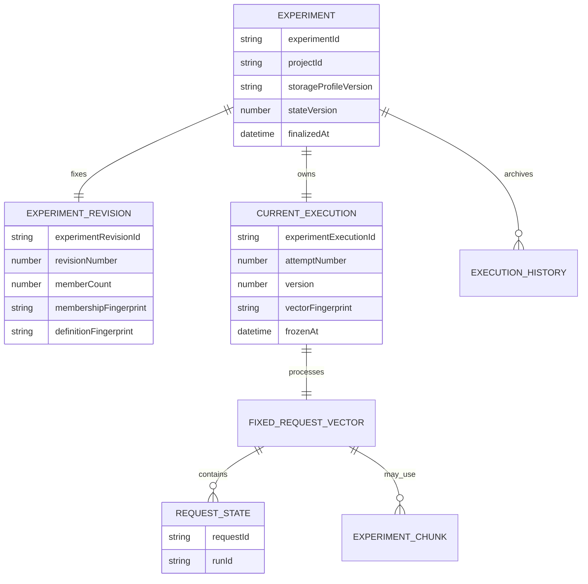
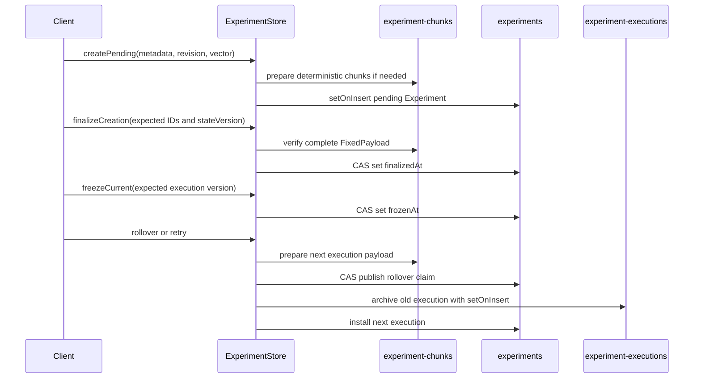

# Experiments Architecture

> **Status:** Foundation, built-in readout, and existing-run membership
> revisions, current as of October 2026.

Experiments are project-scoped, named benchmark compositions. An Experiment
stores durable metadata, one immutable revision, and one current processing
execution. Previous executions are immutable history records.

The foundation provides the canonical storage model, project-scoped public API
contract, CLI commands, Portal creation/list/detail flows, and run correlation.
The built-in `pp-readout` Experiment handler adds generic Reports presentation.
Existing-run membership workflows publish new immutable revisions while
preserving Experiment history as the authority.

## Model



### Revision versus execution

An **Experiment revision** describes the composition itself:

- `experimentRevisionId` and sequential `revisionNumber`;
- exact `memberCount`;
- `membershipFingerprint` for the member set;
- `definitionFingerprint` for the complete definition;
- the canonical, deduplicated, sorted `reportTemplateIds` selected from active
  manual Experiment templates;
- immutable creation time.

An **Experiment execution** is one processing attempt over that revision:

- `experimentExecutionId` and sequential `attemptNumber`;
- optimistic-concurrency `version`;
- the exact request/run vector and its `vectorFingerprint`;
- handler status, blockers, and processing timestamps;
- freeze, discard, and supersession state.

Retry creates a new execution attempt over the same stored request vector. It
does not create a new revision or retry member runs. A membership replacement
instead creates exactly one new revision and one new execution from the
complete next request/run vector.

Replacing `reportTemplateIds` is also revision-producing. Duplicate or
order-only changes are no-ops; a real set change creates revision N+1 and
attempt 1 even when the request/run vector is unchanged. The successor reuses
the immutable built-in readout and completed configurable reports only when
their exact frozen template-version identities are unchanged.

### Configurable report templates

The existing project-scoped report-template catalog serves both runs and
Experiments. A root template has stable `id`, `subject: run | experiment`,
name, description, enablement, and a pointer to immutable content versions.
Every content edit appends a version containing the canonical prompt, optional
system prompt, trigger, model, timeout, and SHA-256 content fingerprint.
Metadata-only edits do not append a content version.

Experiment templates have three distinct modes:

- no trigger: selectable and persisted in a revision's `reportTemplateIds`;
- `trigger: { type: "always" }`: automatic for every completed exact
  execution;
- `trigger: { type: "run-report-templates", reportTemplateIds: [...] }`:
  automatic after all required exact child run reports are ready.

Linked IDs are a canonical non-empty set of active, nondeleted, same-project
`subject: run` templates. Manual selection is atomic: any missing, inactive,
deleted, cross-project, wrong-subject, or automatic ID rejects the full
operation with the invalid IDs.

### Exact request/run vector

Each `ExperimentRequestState` is a bounded, nonrecursive leaf containing the
exact `requestId`, exact `runId`, dependency projections, and blockers captured
for that member. Request IDs are unique within the vector. Each dependency and
blocker list is bounded to 32 entries, and each serialized request state is
limited to 4 KiB.

The exact `{requestId, runId}` identity vector is immutable after publication
and covered by `vectorFingerprint`. Dependency projections and blockers are
mutable bounded state covered by the `FixedPayload` descriptor's
`payloadFingerprint`. Reads reconstruct the original position order and reject
missing positions, duplicates, count mismatches, identity mismatches, or
fingerprint mismatches.

## FixedPayload storage

`FixedPayload<T>` has two representations:

| Representation | Stored on the execution | Use |
| --- | --- | --- |
| `inline` | `entryCount`, `payloadFingerprint`, and `entries[]` | The complete Experiment document fits the operational target |
| `chunked` | `entryCount`, `payloadFingerprint`, assignment version, `bucketCount`, and deterministic `chunkIds[]` | The inline document exceeds the operational target |

The storage profile is versioned as `cosmos-mongo-2mb-v1`.

- **2 MiB hard ceiling:** no selected Experiment or chunk document may exceed
  `maxDocumentBytes`.
- **256 KiB operational target:** inline storage is used only when the complete
  Experiment document is at or below `targetDocumentBytes`.
- Chunk selection reserves 16 KiB for metadata and applies an 80% load factor
  to the remaining target.
- Empty vectors are always inline.
- The bucket search is bounded to 65,536 buckets and fails explicitly when no
  safe layout exists.

### Deterministic routing and chunk identity

Chunk routing is versioned as `sha256-mod-v1`. For a chosen bucket count, the
store hashes:

```text
"experiment-request-bucket:v1\0" + requestId
```

The full SHA-256 digest is interpreted as an unsigned big-endian integer, then
reduced modulo `bucketCount`. This makes assignment independent of input order
and stable across processes.

Chunk IDs are also deterministic. The store serializes this canonical tuple:

```text
["sha256-v1", projectId, experimentId, kind, ownerId, generation, chunkIndex]
```

It hashes the JSON bytes with SHA-256, encodes the digest as base64url, and
prefixes it with `ec_v1_`. `ownerId` is the execution ID and `generation` is
the attempt number. Upserts use `$setOnInsert`; a read-back comparison rejects
an existing deterministic ID whose identity or contents differ.

## Publication and concurrency

Experiment creation and execution rollover use a prepare-then-publish protocol.
Membership replacement uses the same representation-independent protocol:
preplan one complete `FixedPayload`, claim request ownership, archive the
current execution, and atomically install the next revision and execution.



### Compare-and-swap rules

- `stateVersion` protects whole-document publication transitions.
- `execution.version` protects handler claims/completions, freeze, discard, and
  rollover.
- Handler writes require the expected execution ID and version, the expected
  handler version/status, and an unfrozen execution with no rollover claim.
- Freeze competes through the same execution-version compare-and-swap. A
  writer/freezer race has one winner.
- Rollover requires the current execution to be frozen and records an embedded
  claim containing the complete next execution before replacing the current
  pointer.

### Finalization, archive, and repair

`createPending()` may prepare chunks before the root document exists.
`finalizeCreation()` verifies the complete payload and atomically sets
`finalizedAt`. Public `get` and `list` operations return only finalized
Experiments, so partially published state is never visible.

Before rollover, the current execution is frozen. Archival writes an immutable
history document keyed by `experimentExecutionId` with `$setOnInsert`, then
reads it back and requires exact equality. The history record includes the
revision and supersession metadata.

The rollover claim is the repair journal. `repairRollover()` verifies the next
payload, idempotently archives the old execution, and installs the claimed next
execution. A caller can resume this sequence after interruption without
inventing state. Prepared chunks that were never published can be removed with
`discardUnpublished()`.

Membership repair runs before generic rollover repair because denormalized
request ownership must be claimed before publication. Claims use the exact
project, request, and current run IDs. A run retry between planning and claim
aborts the unpublished successor, discards its unpublished chunks, and replans
once from current run identities. Other ownership conflicts abort without
partial publication and report the exact request IDs and current owners.
Replaying a completed mutation returns its deterministic successor revision.

After publication, removed requests have `experimentId` cleared and retained
requests carry the published membership revision. The Experiment revision and
archived exact vectors remain authoritative; `request.experimentId` is only a
denormalized lookup field. An empty membership revision remains visible and
non-dispatchable, and a later add can resume it with another revision.

## Collection and index ownership

| Collection | Owner and contents | Indexes |
| --- | --- | --- |
| `experiments` | One finalized/current document per Experiment; `_id` equals `experimentId` | `{ projectId: 1, _id: 1 }` for project-scoped paging and lookup; `{ "lifecycle.phase": 1 }` for lifecycle repair |
| `experiment-executions` | Immutable archived execution history; `_id` equals `experimentExecutionId` | `{ projectId: 1 }`; `{ experimentId: 1, attemptNumber: -1 }` |
| `experiment-chunks` | Deterministic immutable request-vector chunks | No secondary index; chunks are addressed directly by deterministic `_id` |
| `requests` | Current request ownership and lifecycle provenance | `{ "deletionProvenance.operationId": 1 }` for exact cascade repair |
| `reports` | Current and historical report records with retained artifacts | `{ experimentId: 1 }`; `{ "deletionProvenance.operationId": 1 }` |

The `ExperimentStore` owns root and history writes. `FixedPayloadStore` owns
chunk preparation, read verification, and unpublished cleanup. Migration
`034-create-experiment-storage-indexes.ts` owns the secondary indexes and
intentionally leaves removal to a manual operation in `down()`.
Migration `036-add-experiment-lifecycle-indexes.ts` owns lifecycle repair and
provenance indexes using Cosmos-compatible single-field definitions.

Every lookup includes `projectId` in addition to the entity ID. An Experiment
ID is never resolved globally.

## Runtime ownership

The API owns `ExperimentCoordinator`, including authoritative run projection,
readiness, rollover, retry, publication repair, and Experiment-handler
dispatch policy. Its polling loop repairs missed notifications, vector drift,
dropped queue notices, and interrupted publication or rollover.

`ExperimentLifecycleCoordinator` owns recoverable delete and restore
operations. A stable operation ID and compare-and-swap `stateVersion` advance
the root through `deleting`, `deleted`, and `restoring`. Starting deletion
makes the Experiment non-dispatchable immediately. Exact immutable target
snapshots reuse `FixedPayloadStore`; requests and reports are soft-deleted only
when they were active and receive `{ experimentId, operationId }` provenance.
Independent deletions are never claimed. Restore processes matching children
first, revives the Experiment, then reconciles the current request/run vector
and rolls to a fresh execution only when drift exists. Archived executions and
report blobs remain immutable.

The dispatcher polls lifecycle operations alongside publication repair so
partial cascades, dropped notifications, and process restarts converge. Queue
claims and worker final writes require an active, nondeleted request or report,
which prevents stale in-flight work from publishing after deletion starts.

The scheduler continues to own coding-agent and per-run handler dispatch. For
Experiment handlers it only applies exact claim and completion messages
through shared `ExperimentStore` compare-and-swap primitives. Storage layout,
routing, fingerprinting, and state transitions remain reusable typed modules
under `packages/shared/src/experiments`; they do not own workflow policy.

## Public API

All routes require `?projectId=`:

| Method | Route | Behavior |
| --- | --- | --- |
| `POST` | `/api/v1/experiments` | Create from composed definitions, explicitly empty membership, or `{ mode: "existing", metadata, requestIds }` |
| `GET` | `/api/v1/experiments` | Cursor-page finalized Experiments; `includeDeleted=true` includes lifecycle records |
| `GET` | `/api/v1/experiments/:id` | Read the public Experiment and current execution; `includeDeleted=true` reads a deleted record |
| `DELETE` | `/api/v1/experiments/:id` | Start or resume a recoverable cascading delete and return `202` |
| `POST` | `/api/v1/experiments/:id/restore` | Start or resume child-first restore and return `202` |
| `GET` | `/api/v1/experiments/:id/lifecycle` | Read and repair lifecycle progress and blockers |
| `GET` | `/api/v1/experiments/:id/executions` | List current and archived execution summaries |
| `GET` | `/api/v1/experiments/:id/executions/:experimentExecutionId` | Read one exact current or archived execution |
| `POST` | `/api/v1/experiments/:id/retry` | Start a new processing attempt for the current exact vector |
| `POST` | `/api/v1/experiments/:id/requests` | Add or move standalone requests in one complete-set revision |
| `DELETE` | `/api/v1/experiments/:id/requests` | Remove members to standalone status in one complete-set revision |
| `PUT` | `/api/v1/experiments/:id/report-templates` | Replace the complete selectable manual-template set and publish a revision |
| `POST` | `/api/v1/experiments/:id/executions/:experimentExecutionId/reports/:templateId/retry` | Append a retry version using the execution's frozen template identity |

Creation metadata requires `name` and accepts an optional `description`.
Compose mode requires one or more complete request definitions, existing mode
requires one or more current standalone request IDs, and empty mode requires an
empty request array.

Membership mutation requires the expected current revision ID. Every selected
request must exist in the same project with a current run. Duplicate IDs,
cross-project or missing requests, already-assigned requests, and
Experiment-to-Experiment reassignment fail the complete operation. Direct
member deletion first publishes one removal revision, clears `experimentId`,
and only then soft-deletes the request. A bulk delete can coordinate standalone
requests plus members from one Experiment; selections spanning several
Experiments fail with exact owner conflicts.

The public view exposes identity, project, metadata, revision, current
execution, readiness, blockers, handler progress, supersession, current report,
and linked request summaries when available. Creation additionally returns
`requestIds`. List responses and execution-list responses use
`{ data, nextCursor? }`.

## CLI and Portal

The CLI provides:

```text
scope experiment create
scope experiment create --name <name> --request-id <request-id> [--request-id ...]
scope experiment add <experiment-id> --revision <revision-id> --request-id <request-id> [--request-id ...]
scope experiment move <experiment-id> --revision <revision-id> --request-id <request-id> [--request-id ...]
scope experiment remove <experiment-id> --revision <revision-id> --request-id <request-id> [--request-id ...]
scope experiment list
scope experiment get <experiment-id>
scope experiment executions <experiment-id> [experiment-execution-id]
scope experiment retry <experiment-id> --execution <current-execution-id>
scope experiment reports set <experiment-id> --revision <revision-id> --template <template-id> [...]
scope experiment report retry <experiment-id> --execution <execution-id> --template <template-id>
scope experiment delete <experiment-id> [--no-wait]
scope experiment restore <experiment-id> [--no-wait]
scope experiment status <experiment-id>
```

Creation reuses run configuration flags, adds Experiment metadata, supports
composition preview, explicit empty creation, and creation from existing
standalone requests. `add`/`move` and `remove` accept repeatable request IDs and
print the resulting revision and execution identities. Every command requires
project scope.

Delete and restore commands poll the stable lifecycle operation by default.
`--no-wait` returns the accepted state immediately for automation that polls
separately. `scope experiment status` prints exact progress and blockers, while
`list --include-deleted` and `get --include-deleted` expose recoverable records.

The Portal provides `/experiments`, `/experiments/new`, and
`/experiments/:id`. The shared creation form retains the established run
configuration and expansion count and adds Experiment metadata. No selected
scenario creates an empty Experiment; selecting a scenario reveals the run
composition controls and creates the expanded run count. Optional description
editing is collapsed by default and preserves its value when reopened. The
revealed Observation picker opens the shared authoring wizard in locked
`mode="observation"` and adds the created ID only to the Experiment
composition's selected observations. The
project-scoped creation launcher keeps **New Run** as the primary action and
expands to expose **New Experiment** on pointer hover or keyboard focus; the
expanded sidebar and mobile sheet keep both destinations directly available.
The Portal navigates to Experiment Detail after creation. The Experiments list uses the shared
full-height, edge-to-edge `ListLayout`, `FilterRail`, `DataTable`, column
customization, and cursor-aware `Pagination` interaction model used by Runs
while retaining Experiment-specific status, revision, attempt, and run-count
columns.

Experiment Detail keeps the Experiment identity, concise status, and global
attempt selector in a compact header. The horizontal **Runs**, **Reports**, and
**Processing** tabs follow that header directly so their active content is
available without scrolling through overview cards. The selected attempt
scopes all three tabs:

- **Runs** renders the exact stored request/run vector in an inset,
  sortable, customizable, paginated shared `DataTable`. Rows link to the exact
  request/run pair.
- **Reports** groups append-only report documents by persisted `templateId` or
  reporter identity. It shows a type selector only when multiple report types
  exist and a version selector only when a type has history. The newest type
  and newest version are the defaults, and exactly one version is rendered.
  Markdown, structured JSON, the global report-detail link, loading/error
  retry, and status use the exact
  `experimentId + experimentExecutionId + reportId` identity. Completed,
  processing, failed, blocked, and no-artifact states share one stable panel
  shell: identity, selectors, badges, and actions keep their positions while
  only the content region changes. Artifact-only actions are disabled when no
  artifact exists, while addressable report versions retain their direct link.
- **Processing** owns handler progress, blockers, errors, execution metadata,
  and processing retry/recovery. Retry remains current-attempt-only.

Browser history preserves the selected attempt, tab, report type, and report
version through `executionId`, `tab`, `reportType`, and `reportId` query
parameters. Missing parameters retain backward-compatible defaults. Stale
values fall back safely to the current data and are removed from the URL.
Detail defaults to **Reports** when a report document exists, **Processing**
while an artifact-free attempt is active or blocked, and **Runs** otherwise.
Public UI terminology remains generic **Reports**; `pp-readout` is only the
internal handler identifier. The Processing tab separates selectable manual,
automatic-always, and automatic linked-run templates, shows matching-run
counts and independent blockers, and warns that selection changes publish a
revision. Configurable types coexist with `pp-readout` in the existing compact
type selector and append-only version selector.
Run list and detail views link `experimentId` back to the Experiment. A
historical correlation that has no Experiment document is view-only and cannot
trigger retry.

The Runs list can bulk-create an Experiment from eligible standalone selections
or move them into an existing Experiment. The current attempt's Runs tab can
select and remove members back to standalone status in one revision-guarded
operation; historical attempts remain read-only. Conflicts keep the selection
visible, identify ineligible requests and owners, and avoid partial navigation.
Coordinated deletion warns about membership changes and shows the resulting
revision.

The Experiments list hides deleted records by default and provides a
**Show deleted** toggle. Experiment Detail displays lifecycle phase, operation
ID, request/report progress, and exact blockers. Deletion uses an explicit
confirmation dialog; a deleted Experiment exposes **Restore**. Membership,
retry, and report publication controls stay disabled while lifecycle work is
active.

## GEPA optimizer integration

`apps/gepa-optimizer` treats the Experiment model as the durable record of one
prompt-optimization run:

1. It creates one empty Experiment, or targets `SCOPE_EXPERIMENT_ID` and reads
   its current revision.
2. Each candidate batch submits standalone requests without retrying the
   submission POSTs.
3. It adds the successful request IDs in one revision-guarded membership POST.
4. It polls the exact request runs and exact `experimentExecutionId` using
   idempotent GET retries, then reads reports from that exact execution.
5. It stores `experimentId`, `experimentRevisionId`,
   `experimentExecutionId`, and report references in GEPA outputs and
   reflective trajectories.

The Experiment therefore remains operable through the normal API, CLI, and
Portal. Membership revisions provide the durable candidate-batch boundaries;
the algorithm-specific criteria score and post-hoc candidate lineage remain in
the optimizer's `results.json` rather than extending Scope persistence.

## Permanent request creation and composition deprecation

`POST /api/v1/requests`, `scope run submit`, and the Portal's **New Run** flow
remain permanent for one request, including:

- one inline/manual configuration;
- one saved profile;
- ordinary model, tool, criterion, resource, and codebase configuration;
- `count: 1`;
- no profile variations.

Only these overlapping request-creation controls are deprecated:

- `count` greater than `1`; or
- a non-empty `profileVariations` array.

Clients identify this case as `legacy-request-composition`. Existing expansion,
response, status, and navigation behavior remain intact. The CLI writes the
warning only to stderr. Beside the relevant **New Run** composition controls,
the Portal gives neutral contextual guidance linking to **New Experiment**
without presenting the supported legacy path as an error or alert. New
multi-request compositions use Experiment creation.

## Deferred capabilities

GEPA restacking is excluded from the Experiment lifecycle implementation.

## Key files

| File | Purpose |
| --- | --- |
| `packages/shared/src/experiments/types.ts` | Canonical Experiment, revision, execution, and `FixedPayload` types |
| `packages/shared/src/experiments/schemas.ts` | Strict persisted-boundary validation |
| `packages/shared/src/experiments/layout.ts` | BSON limits and inline/chunked layout selection |
| `packages/shared/src/experiments/routing.ts` | SHA-256 bucket routing, chunk IDs, and fingerprints |
| `packages/shared/src/experiments/fixed-payload-store.ts` | Deterministic chunk publication and verified reads |
| `packages/shared/src/experiments/lifecycle-target-store.ts` | Exact chunk-backed lifecycle target snapshots |
| `packages/shared/src/experiments/experiment-store.ts` | Creation, CAS processing, freeze, archive, rollover, retry, and repair |
| `packages/db-migrations/src/migrations/034-create-experiment-storage-indexes.ts` | Collection index ownership |
| `packages/db-migrations/src/migrations/035-version-report-templates.ts` | Existing-template backfill, immutable template versions, and report lookup indexes |
| `packages/db-migrations/src/migrations/036-add-experiment-lifecycle-indexes.ts` | Lifecycle repair and deletion-provenance indexes |
| `apps/api/src/experiment-coordinator.ts` | API-owned workflow policy and repair |
| `apps/api/src/experiment-lifecycle.ts` | Recoverable delete/restore orchestration and reconciliation |
| `apps/api/src/experiment-membership.ts` | Complete-set membership validation, request ownership, publication, and repair |
| `apps/api/src/experiment-dispatcher.ts` | Durable polling and queue delivery |
| `apps/cli/src/commands/experiment.ts` | Project-scoped CLI surface |
| `apps/portal/src/lib/experiments.ts` | Public response parsing |
| `apps/portal/src/pages/ExperimentsList.tsx` | Experiment list |
| `apps/portal/src/pages/ExperimentDetail.tsx` | Current state, history, and retry |
