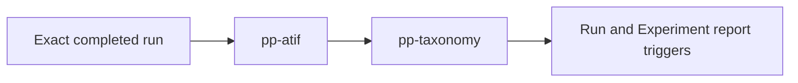

# Post-Processing Pipeline

The post-processing pipeline generates immutable derived artifacts from exact
benchmark run attempts. It is an at-least-once handler DAG: coder workers notify
the scheduler when a run becomes terminal, the scheduler dispatches eligible
handlers, and the post-processor worker atomically claims one exact
`{requestId, runId, handlerId}` before execution.

## Handler DAG



`run.handlerStatus[handlerId]` is authoritative. The deprecated flat
`run.postProcessorStatus` and `run.postProcessorVersion` remain compatibility
mirrors for `pp-atif`.

### Claim and delivery semantics

Queue delivery is at least once. A worker claim:

1. matches the exact request and current run ID;
2. requires a completed run;
3. accepts absent or `queued` state;
4. rejects another `processing` claim;
5. applies the handler version/backfill rule;
6. writes `status: processing` plus a fresh claim token.

Handler publication and the terminal `done`/`failed` write both match that claim
token. Duplicate messages no-op, and work from a stale run attempt or stale
claim cannot publish into the current attempt.

## ATIF generation (`pp-atif`)

`pp-atif` converts each iteration's HAR recording with `atifact` and uploads the
canonical trajectory to:

```text
{requestId}/runs/{runId}/iteration-{N}/atif.trajectory.json
```

The exact turn stores its stable `atifUrl`. The handler supports both HTTP/SSE
and WebSocket HAR captures. Its focused unit tests mock conversion, while the
WebSocket fixture test exercises the real parser.

## Taxonome evaluation (`pp-taxonomy`)

`pp-taxonomy` runs after ATIF and evaluates the exact Experiment-pinned taxonomy
revision against the exact run's ATIF artifacts.

### Resolution and integrity

The handler reads the Experiment execution's bounded pin:

```typescript
{
  taxonomyRevisionId: string;
  ref: string;
  contentSha256: string;
}
```

It resolves the taxonomy revision by database ID, project, canonical ref, and
content SHA, then resolves every element by an explicit `{id}@rN` ref in the
same project. Stored path references are rejected because production revisions
must be fully resolved before execution.

### Programmatic execution

The worker uses `taxonomy-engine` directly:

- ATIF inputs are downloaded from the exact run and normalized/upcast;
- stored taxonomy and element documents are normalized with the catalog's
  reviewed deterministic handler registry;
- deterministic-only taxonomies do not initialize a model client;
- prompt execution is injected, with production lazily creating an isolated
  Copilot transport and tests supplying a fake executor;
- `TAXONOME_MODEL` independently selects the prompt-evaluation model and
  defaults to `claude-haiku-4.5`; coding-run model and reasoning effort are
  never forwarded, while `auto` remains an explicit provider-resolved option;
- explicit Taxonome model IDs are validated against the SDK model catalog
  before session creation, while reasoning effort is omitted for provider/model
  compatibility;
- no Taxonome CLI process is started and no CLI output is parsed.

### Artifact publication

The full SDK result is serialized once, SHA-256 hashed, gzip compressed, and
uploaded to a claim-specific path:

```text
{requestId}/runs/{runId}/taxonomy-evaluation/{claimId}/result.json.gz
```

The exact run stores only:

```typescript
taxonomyEvaluation?: {
  url: string;
  schemaVersion: string;
  contentSha256: string;
  sizeBytes: number;
}
```

The URL is a stable non-SAS blob URL. Publication compares the request, run,
`pp-taxonomy` processing state, and claim token in one MongoDB update.
Historical run attempts retain their own references.

## Typed Experiment readout

The Experiment readout route walks the immutable request/run vector. For every
pair it verifies the stored evaluation SHA before decoding the compressed
artifact and records one of:

- `completed` — full Taxonome result, preserving passed/negative and
  unknown/indeterminate assessments;
- `runtime-failure` — handler or artifact integrity failure;
- `missing` — exact run or result is unavailable.

Generation writes structured JSON and deterministic Markdown blobs. It does
not invoke a generic LLM synthesizer. A claim token and exact execution ID guard
publication, so retrying or rolling an Experiment cannot attach a stale readout
to a newer execution.

## User-facing access

The API exposes exact-run evaluation metadata/content and Experiment readout
status, JSON, Markdown, and retry routes. These entry points are gated by the
DB-backed `taxonome` flag. Internal handlers and schedulers deliberately do not
read the flag; turning it off hides new user entry points without interrupting
accepted work.

Run list responses and exact Experiment execution members include only a
bounded `taxonomyHandler` summary derived from the persisted
`run.handlerStatus["pp-taxonomy"]` entry and whether the exact run has a
`taxonomyEvaluation` reference. List pages never read or probe result blobs.
The Portal renders these states as:

- no handler entry: unavailable;
- `queued`: queued;
- `processing`: processing;
- `failed`: failed, with the persisted error available in the tooltip;
- `done` with a result reference: completed;
- `done` without a result reference: result unavailable.

Run Detail loads the typed result only when its Taxonomy tab is active and the
exact run has a result reference. The JSON view route,
`GET /api/v1/requests/:id/runs/:runId/taxonomy-evaluation/json`, enforces the
feature flag and exact request/run ownership, rejects results above
`TAXONOMY_RESULT_MAX_BYTES`, decompresses the gzip artifact with the same bound,
verifies the uncompressed size and SHA-256, parses JSON, and validates the full
Taxonome result schema before returning it. The existing compressed download
route remains the source for downloading the immutable artifact.

Phase 1 intentionally exposes persisted coarse state only. Element totals,
per-element progress, inferred dependency-blocked states, and SDK progress
hooks are deferred.

## Handler registration

Handlers implement:

```typescript
interface PostProcessHandler {
  readonly type: string;
  readonly version: number;
  readonly autoBackfill: boolean;
  process(message: PostProcessorMessage, context: HandlerContext): Promise<void>;
}
```

The worker builds `handlerId` as `pp-${type}`. YAML handler registration remains
the scheduler's topology source, and the scheduler notification endpoints are
best-effort accelerators around the poll safety net.

## Validation

Focused validation covers:

- real HAR-to-ATIF WebSocket conversion;
- absent/queued/stale-version claim transitions;
- duplicate and stale message no-ops;
- taxonomy ref/path schema rejection and canonical content hashes;
- no model executor initialization when no taxonomy work is selected;
- API/OpenAPI Experiment taxonomy pinning;
- Portal fail-closed feature visibility and Storybook interactions;
- CLI command-tree snapshots.
