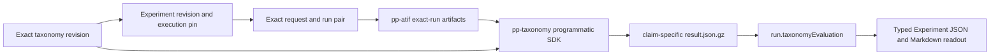
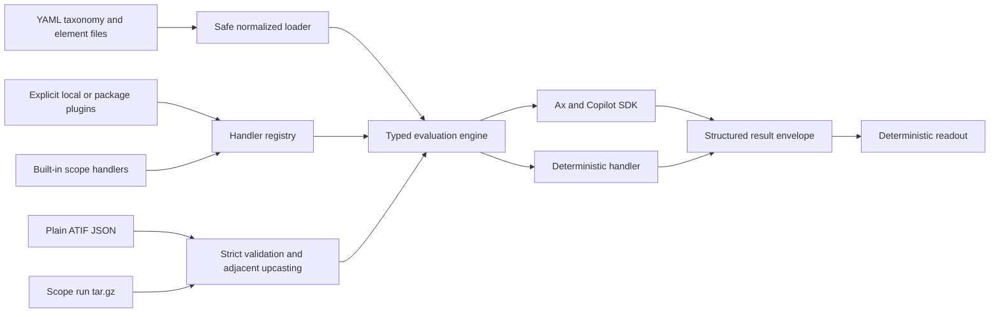

# Taxonome: YAML-driven taxonomy evaluation spike

The normative interoperable authoring/result/reference contract is
[Trajectory Taxonomy Format](trajectory-taxonomy-format.md). This guide covers
the Taxonome implementation, CLI, experiments, and evidence.

Taxonome began as a standalone experimental slice and remains independently
usable through its CLI. Scope now also integrates the same engine as the
production taxonomy catalog and Experiment post-processor. It loads authored
taxonomy definitions from YAML, validates/upcasts ATIF v1.6-v1.8 trajectories,
and returns
schema-validated structured observations. The current catalog slice contains:

- prompt-based Skipped Invocation through Ax and the GitHub Copilot SDK;
- prompt-based Wrong Discovery and Content Misused;
- deterministic Discovered, Malformed Invocation, and Timeout through reviewed
  TypeScript;
- explicit third-party deterministic handler plugins;
- plain ATIF JSON and existing Scope run archive inputs;
- deterministic JSON/Markdown readout previews.

The standalone CLI still requires no Scope API, Judge, database, Redis, queue,
or token manager. The production integration uses the API, Cosmos-compatible
MongoDB collections, post-processor queue, and Blob Storage, but invokes the
Taxonome programmatic API directly; it never shells out to this CLI or parses
CLI output.

## Scope production integration

The production catalog consists of exactly four project-scoped collections:
`taxonomies`, `taxonomy-revisions`, `taxonomy-elements`, and
`taxonomy-element-revisions`. Roots are mutable metadata records. Revisions
are immutable, monotonically numbered, and addressed as `{id}@rN`.

The canonical `packages/ax-taxonomy/taxonomy/taxonomy.yaml` and referenced
element files seed a per-project **ax-taxonomy** root as `sourceType: builtin`.
Built-ins are read-only. Copying an exact built-in revision creates a new user
root at revision 1. User edits always append revisions.

The API validates explicit element references and rejects ambiguous objects,
bare IDs, malformed refs, absolute/traversing paths, missing YAML files,
duplicate element IDs, cross-project refs, and implicit-latest resolution.
Portable YAML contains the established top-level Taxonome schema without a
database-only definition wrapper. Database revisions additionally carry
`contentSha256` for latest-revision deduplication and integrity verification;
exports omit it.

### Experiment and exact-run flow



`pp-taxonomy` resolves every element by exact canonical ref and rechecks the
taxonomy revision's database ID, project, ref, and content SHA. Deterministic
taxonomies create no Copilot model transport. Prompt execution is injectable;
tests use fake executors and make no paid or live calls. Production opens an
isolated Copilot transport lazily only when at least one selected element is
prompt-based. Scope's post-processor selects that transport through the
dedicated `TAXONOME_MODEL` setting (`claude-haiku-4.5` by default), never
through the originating coding run's model or reasoning effort. Explicit model
IDs are validated against the Copilot SDK catalog (`auto` remains an explicit
provider-resolved option), and the post-processor omits reasoning effort so
models without configurable effort remain supported.

Artifact paths are attempt/claim specific:

```text
{requestId}/runs/{runId}/taxonomy-evaluation/{claimId}/result.json.gz
```

The worker publishes the complete bounded run reference atomically only while
the exact run and `pp-taxonomy` claim still match. Duplicate queue delivery,
stale claims, and historical attempts therefore cannot overwrite one another.

### Feature flag and product surfaces

The DB-backed `taxonome` feature flag is seeded idempotently with label
`Taxonome and Taxonomies` and `enabled: false`. It gates only user entry points:
taxonomy APIs, taxonomy-bearing Experiment mutations, Portal navigation/routes/
queries, and CLI calls through those APIs. Workers, schedulers, and internal
pollers do not consult it, so disabling the flag does not interrupt accepted
work. Portal behavior is fail-closed while flag state is unresolved.

The API is the source of truth for taxonomy roots, revisions, copy, YAML
import/export, elements, exact-run artifacts, and typed readouts. Portal and
CLI clients use those routes and add no client-only capabilities.

`GET /api/v1/taxonomies?projectId=...` returns scan-ready rows enriched from
the latest revision in one bulk read: exact ref, portable semantic version,
element count, source/read-only state, and root metadata. The project-scoped
`GET /api/v1/taxonomies/:taxonomyId/detail?projectId=...&revisionId=...`
returns the root, selected exact taxonomy revision, bounded revision summaries,
and the selected revision's element refs resolved in authored order to exact
element root/revision pairs. Resolution uses bulk `$in` reads and never expands
the unrelated project element catalog.

The Portal uses the shared list/table primitives for taxonomy discovery and a
dedicated detail route for history and exact ordered elements. Prompt editing
is available only for user-owned prompt elements on the latest active taxonomy
revision; one edit appends an element revision and then a taxonomy revision
that pins the new exact element ref. Built-in, deterministic, deleted, and
historical rows remain read-only. `scope taxonomy show` consumes the same detail
projection, including optional historical revision selection.

### Standalone foundation extraction

The foundation carries the complete Taxonome-owned feature delta from
`6ae17ce30247bb893ab85af170c4c5e290228dd5` to the committed source
`db28fbeee54bd2d59e4a50aff8ad3040038b35ef`, applied onto the earlier
post-processing DAG base `21ad65b8aa33dbf15b04b79a28cba0010f2e52f4`.
It does not carry the intervening Observation/Experiment implementations or
the native Scope CLI submission-filtering/archive-download changes. Production
post-processor and report-consumer integration remain deferred.

The only shared runtime addition is the `shared/schemas/request` subpath
export. Archive ingestion validates the existing `RunStateSchema` through
that narrow entry point; no later run schema, database model, scheduler, or
service implementation is imported into this layer. The static-prompt
inventory retains the early base's ten quality families (15 adapter variants)
and adds the three standalone Taxonome targets, not later Experiment targets.

Committed model-call ledgers, optimization outputs, readouts, hashes, and
manifests below remain historical source evidence. Their original identifiers
and source paths are preserved, not reinterpreted as new acceptance results
for this extraction. Foundation validation uses offline fixtures and mocked
model transports; it does not rerun paid inference or optimization, regenerate
historical evidence, recalibrate semantics, or introduce production telemetry.

## Architecture

The same normalized taxonomy, ATIF stream, registry, and result envelope serve
single-element and mixed evaluation:



ATIF ingestion is deliberately discoverable under
`packages/taxonomy-engine/src/atif/`:

- `validators/v1.6.ts`, `v1.7.ts`, and `v1.8.ts` pin strict historical core
  schemas;
- `upcasters/v1.6-to-v1.7.ts` and `v1.7-to-v1.8.ts` are pure adjacent
  conversions;
- `ingest.ts` owns singleton-root decoding, per-hop validation, canonical v1.8
  assembly, and structured diagnostics;
- `source-map.ts` composes original JSONPath mappings across wrappers,
  upcasters, generated Scope values, archives, and JSONL fields;
- `scope-extensions.ts` validates and normalizes only legal `extra.scope`
  namespaces.

The `taxonomy-engine` package root does not import Ax or the SDK. Prompt
execution is explicitly provided by `taxonomy-engine/copilot`, so a
deterministic-only process does not initialize the SDK and needs no token.

### ATIF copy ownership and allocation benchmark

The canonical document remains a plain, fully materialized object. Ingestion
uses the source validator's newly allocated known ATIF objects as its ownership
boundary. Because Zod intentionally passes values beneath `z.unknown()` by
reference, `atif/ownership.ts` detaches all opaque `extra`, argument, metric,
tool-definition, and reference payloads in one graph-preserving
`structuredClone` batch. Upcasters and Scope normalization then mutate only
these validation-owned intermediates. Their public standalone helpers remain
pure and copy their inputs.

Required source/target/final validation still allocates Zod parse results.
Those copies are intentional and are not bypassed for performance. Archive
stitching similarly moves already-owned normalized steps into the synthetic
document before its normal ingestion/validation pass instead of cloning every
step again.

The allocation benchmark is developer-invoked and has no noisy CI threshold:

```bash
node --expose-gc --import tsx \
  packages/taxonomy-engine/benchmarks/atif-copy-minimization.mjs \
  --output /tmp/atif-copy-benchmark.json
```

It runs representative v1.6/v1.7/v1.8 opaque, Scope-response, embedded-child,
and real-playbook workloads in fresh processes. It records sampled V8
allocations, observed/retained heap and RSS, duration, canonical hashes,
source-map counts, and caller/output reference sharing. Compare results only
for the same Node/platform, benchmark revision, workloads, and fresh-process
repeat count.

The shipped taxonomy is the separate `ax-taxonomy` catalog package. It owns
only taxonomy definitions, concrete handlers, focused catalog tests/fixtures,
and minimal asset/registration exports. Timeout lives in
`packages/ax-taxonomy/src/handlers/timeout/handler.ts`, with co-located
`handler.test.ts`. The CLI explicitly composes both packages; the engine never
imports the catalog, so the dependency remains one-way.

| Element | Implementation | Evidence boundary |
|---|---|---|
| Discovered (`beh-discovered`) | `scope/discovered-v1` | Recorded `step.extra.scope.discoveries` only |
| Skipped Invocation (`beh-skipped-invocation`) | Prompt | Task-relevant recorded discovery was never used |
| Wrong Discovery (`beh-wrong-discovery`) | Prompt | Recorded discovery does not fit the task or is materially less relevant |
| Content Misused (`beh-content-misused`) | Prompt | Returned source content is later contradicted, misrepresented, or applied incorrectly |
| Malformed Invocation (`beh-malformed-invocation`) | `scope/malformed-invocation-v1` | Explicit `tool_call.extra.scope.input_validation` evidence only |
| Timeout (`beh-timeout`) | `scope/timeout-v1` | Explicit timeout or reliable timing plus authored policy |

## Build and run

From the repository root:

```bash
pnpm install --frozen-lockfile
pnpm --filter taxonomy-engine build
pnpm --filter ax-taxonomy build
pnpm --filter taxonome build
taxonome run \
  packages/ax-taxonomy/fixtures/timeout.atif.json \
  --taxonomy packages/ax-taxonomy/taxonomy/taxonomy.yaml \
  --elements beh-timeout
```

`run`, `eval`, and `optimize` require `--taxonomy`; there is no automatic
taxonomy discovery. The exact authored schema identifier is
`scope/taxonomy/v1`. The CLI accepts plain ATIF JSON or a Scope `.tar.gz` archive and detects
archive content by gzip bytes, not filename. An archive can contain one run
root or an ordered collection of run roots.

Use direct `taxonome ...` commands for repository development and demos after
placing the built binary or wrapper on `PATH`.
`run`, `eval`, and `optimize` write concise human-readable stdout by default,
including when redirected. Pass `--json` for their complete machine-readable
JSON shapes; this output is never styled. `readout` retains its existing JSON
stdout plus optional `--markdown` file. Diagnostics and help go to stderr.
Interactive diagnostics use restrained semantic color; redirected output, CI,
`TERM=dumb`, `NO_COLOR`, and `FORCE_COLOR=0` are plain. Nonzero `FORCE_COLOR`
enables diagnostic color, and meaning never depends on color alone.

Human `run` output shows taxonomy/run context and each element's strategy,
state, observation, occurrence count, grounded references, reason, or error.
Human `eval` output names the elements, input/ground-truth files, split,
original-versus-artifact configuration, inputs, repetitions, pass/fail counts,
and each failing
assertion/runtime error. It explicitly warns that runtime/configuration errors
make detector-quality interpretation invalid. Human `optimize` output reports
the artifact path, optimizer score, corpus counts, learned traces/examples,
metric entries, instruction proposals, early-stop state, and metric-call limit
without claiming an unmeasured accuracy gain.

Prompt execution resolves a token in this order:
`COPILOT_GITHUB_TOKEN`, `GH_TOKEN`, `GITHUB_TOKEN`, then the active account from
`gh auth token`. The GitHub CLI command is invoked directly with `execFile`
(never a shell); its stdout is trimmed and held only in memory, while stderr
and credential values are never printed or persisted. Without an environment
override, `gh` must be installed and authenticated with `gh auth login`.

The resolved token is passed directly to `CopilotClient` with `mode: "empty"`
and `useLoggedInUser: false`. `COPILOT_HOME`, `HOME`, the SDK base directory,
and working directory all remain isolated in one temporary directory. The
child receives only `PATH` and `TMPDIR`; SDK-supported token environment
variables are not forwarded because the static token is already resolved.
Every session denies tools, MCP, skills, plugins, custom instructions, config
discovery, file hooks, host Git, persistence, telemetry, and runtime retries.
Never put a token in a flag, taxonomy, plugin configuration, committed file,
or diagnostic.

### Evaluate the shipped catalog from `ax-taxonomy`

The catalog package exposes one cycle-free command that invokes the root
Taxonome CLI without depending on the `taxonome` application package:

```bash
cd packages/ax-taxonomy
pnpm eval -- --help
pnpm eval
pnpm eval -- --element beh-wrong-discovery
pnpm eval -- --json
```

Authentication automatically uses the active `gh` account, with the three
supported token environment variables as higher-priority CI overrides.

The package script delegates directly to native `taxonome eval`, supplying the
catalog taxonomy and these quoted repeatable patterns:

```text
--inputs "packages/ax-taxonomy/fixtures/*-inputs.jsonl"
--ground-truth "packages/ax-taxonomy/fixtures/*-ground-truth.json"
```

Taxonome resolves each pattern itself, fails unmatched patterns, sorts and
deduplicates overlapping matches, and merges files by stable input ID plus
element ID. Duplicate input IDs, duplicate ground-truth pairs, and missing
ground truth fail with source filenames. Inputs are never paired positionally.

Each input's `elements` array determines applicability. With no selector, every
input is evaluated against its declared elements. `--element <id>` filters to
inputs that declare the stable ID and evaluates only it; unknown/repeated
selectors fail before input resolution. The active split vocabulary is
`train | validation | test`, with `test` meaning final unseen evaluation for
both prompt and deterministic inputs. Ordinary unit coverage remains in
Vitest, not evaluation data. The default is `all`.

The current CLI has no cumulative budget, durable counter, `--ledger` option,
or `budget` result metadata. The frozen spike evidence used a one-off
reserve-before-send ledger to control and audit that experiment. Its JSONL
files, captured budget fields, and provenance remain historical evidence only;
they are not a current runtime feature. `passed` / `total` counts judged input
executions, not successful agent tasks or SDK calls.

The Wrong Discovery and Content Misused corpora each contain nine opaque-ID,
reviewed inputs across disjoint train/validation/test families and
originating runs. They cover positive, negative, indeterminate/preflight, and
prompt-injection-resistant evidence. These committed corpora and offline
composition checks are not model-accuracy evidence.

Human progress is streamed to stderr at input and element boundaries before
the final stdout summary. Every element is labeled `Prompt` or
`Code/Deterministic`, with model-call behavior stated explicitly. Reviewed
failures do not stop later inputs/elements; the final exit status aggregates
all failures. Progress uses normal TTY color and is plain under `NO_COLOR`,
non-TTY streams, and JSON mode. The package pins pnpm's reporter to silent, so
`pnpm eval -- --json` remains one ANSI-free JSON document on stdout.

The evaluator flattens selected sample/input/element combinations into stable
jobs and executes them through a bounded global pool. `--concurrency <1..16>`
defaults to `4`; result rows remain in planned order regardless of completion
order. Each worker owns an independent lazy prompt executor/SDK transport and
reuses it only while healthy. Deterministic-only workers never initialize the
SDK. A poisoned prompt transport is closed and replaced before that worker's
next prompt job; final cleanup closes every worker independently and reports
all failures.

TTY stderr uses an in-place numeric dashboard with taxonomy-ordered rows:
`STATUS TYPE ELEMENT DONE PASS FAIL RUN WAIT ACTIVE`, plus overall
complete/pass/fail/running/waiting counts. Multiple active jobs show the first
stable input plus `+N`. Running status is cyan, Prompt magenta, Code blue, pass
green, fail red, and waiting dim. `NO_COLOR` preserves in-place updates without
color. JSON disables dashboard/cursor controls; non-TTY output is append-only.
Dashboard state is finalized before stable element/input/sample failure
details and the elapsed-time summary are appended.

SIGINT stops scheduling, aborts active prompt requests through the shared
cancellation signal, closes all runtimes, restores cursor state, and exits
nonzero.

After an interactive dashboard is finalized, stderr receives only grouped
failure details and stdout receives one compact evaluation-level line:
`Result  <pass> passed • <fail> failed • <total> evaluations • <seconds>s`
(plus cancelled when nonzero). Counts come from element jobs, so a
multi-element input contributes multiple evaluations. Successful inputs are
not repeated after the dashboard. Non-TTY human output intentionally retains
the detailed input/file summary; JSON fields and row ordering remain unchanged
apart from the additive evaluation-level counts.

`--element-override <path>` is repeatable for `run` and `eval`. Each path is a
complete standard Taxonome element YAML whose exact `id` replaces one authored
taxonomy element before validation and digest calculation. Duplicate, unknown,
or mismatched IDs fail before model initialization. The optional sibling
optimization manifest is provenance only and is never required at runtime.
`optimize --in-place --from-candidate <optimized.yaml>` publishes the exact
selected YAML and matching provenance manifest without rerunning model
selection. Candidate identity, taxonomy digest, contract hash, and semantic
content hash must all match before the transactional write.

## Authored taxonomy contract

A taxonomy may embed element definitions or reference manifest-relative
per-element YAML. Both forms normalize to the same immutable typed structure.
References must remain under the taxonomy root and cannot traverse symlinks.
YAML aliases/anchors, duplicate keys, repeated/cyclic references, unknown
handlers, duplicate element IDs, and unsupported JSON Schema features fail
explicitly.

```yaml
schema_version: scope/taxonomy/v1
id: ax-taxonomy
version: 1.0.0
surfaces:
  - id: surface-mcp
    label: MCP
elements:
  - path: elements/timeout.yaml
```

Element YAML owns metadata, declared surfaces, actual prompt instructions,
implementation selection/configuration, evidence requirements, and output
schema. Deterministic YAML refers to an origin-independent handler ID, never a
module path:

```yaml
schema_version: scope/taxonomy/v1
id: beh-timeout
label: Timeout
category_id: behavior-category-invocation
implementation:
  type: deterministic
  handler: scope/timeout-v1
  config:
    threshold_ms: 1000
preconditions:
  requires_complete_trajectory: true
output_schema:
  type: object
  required: [state]
  additionalProperties: false
  properties:
    state:
      enum: [completed, indeterminate, inapplicable, error]
```

The supported authored JSON Schema subset is deliberately non-executable:
`type`, `const`, `enum`, `properties`, `required`,
`additionalProperties`, `items`, `minItems`, `minimum`, and `oneOf`.
`$ref`, recursive schemas, and custom keywords are rejected. Schema depth and
node counts are bounded. The taxonomy digest is a canonical semantic SHA-256,
so formatting and key order do not change it.

### Tool input-validation evidence

Producers may attach strict machine-readable validation evidence to a tool call:

```json
{
  "extra": {
    "scope": {
      "input_validation": {
        "status": "invalid",
        "issues": [
          {
            "code": "invalid_type",
            "path": "$.limit",
            "message": "Expected a number."
          }
        ]
      }
    }
  }
}
```

`status` is exactly `valid`, `invalid`, or `unknown`. `invalid` requires at
least one strict issue with a stable `code` and optional `path`/diagnostic
`message`; `valid` and `unknown` carry no issues. Plain ATIF and archive
stitching preserve this evidence. Malformed Invocation uses only this field:
generic prose and `outcome:"error"` never prove malformed input. Explicit
invalid evidence survives partial trajectories; missing/unknown validation is
indeterminate when no positive exists; complete runs with no calls or only
explicitly valid calls are completed false.

## Handler registry and plugins

One registry resolves built-in, local-project, and installed-package handlers.
Built-ins reserve the `scope/` namespace. External plugins must use their own
namespace, such as `acme/retry-loop-v1`; unknown and duplicate IDs fail without
override.

Plugins are loaded only through repeatable `--plugin` flags or an injected
programmatic registry. A plugin exports the exact versioned contract
`scope/taxonome-plugin/v1` and registers deterministic handlers with a config
validator and implementation:

```typescript
import { defineTaxonomePlugin } from "taxonomy-engine/plugins";

export const taxonomePlugin = defineTaxonomePlugin({
  api_version: "scope/taxonome-plugin/v1",
  provider: {
    name: "acme-taxonomy-handlers",
    version: "1.0.0",
  },
  handlers: {
    "acme/retry-loop-v1": retryLoopHandler,
  },
});
```

Relative plugin paths and installed package names resolve from the invocation
working directory, including when Taxonome itself is globally installed.
Dependencies resolve from the plugin location through normal Node module
resolution. Taxonome does not scan directories or `node_modules`, install
packages, perform network lookup, or import a module named by YAML.

Plugin imports and top-level code run with the Taxonome process permissions.
This is **not a sandbox**. Frozen input/config/output validation protects data
contracts and mutation invariants, not the host from malicious plugin code.
Provider origin, version, entry point, and integrity metadata appear in result
provenance but do not change the origin-independent YAML handler ID.

The complete developer example is
[`examples/taxonome-custom-handler`](../../examples/taxonome-custom-handler/README.md).
It builds a local plugin and runs the same taxonomy against plain ATIF and a
Scope archive without publishing an npm package. Its deterministic producer
declares a Zod output schema, infers the `RetryOutput` type, types each
occurrence, and returns `indeterminate` when explicit recovered-retry evidence
lacks required source attribution. A focused test checks representative
producer outputs against both the TypeScript schema and the YAML runtime schema.
The example exposes that offline code test as `pnpm test:handler`; it executes
the TypeScript handler directly and makes no SDK calls.

The same example also contains a custom prompt element and a small disjoint
train/validation/test packet. From the example directory, a real
`taxonome` executable can run the prompt, evaluate fixed test ground truth,
perform one bounded Ax optimization, write complete optimized element YAML plus
a provenance-only manifest, and re-evaluate with `--element-override`. The
current neutral-control inputs
use opaque model-visible session/run/scenario/profile identities, distinct
families and originating runs, separate ground truth, and no element ID or
label in trajectory text. A regression serializes each input with the
production `taxonomyPromptEvidence()` projection and verifies that
input/family/origin
metadata is absent and every forwarded identity is outcome-neutral.
Current user-facing paths name the subject and role explicitly:
`datasets/repeated-request/trajectory-inputs.jsonl`,
`datasets/repeated-request/ground-truth.json`,
`inputs/repeated-request/example-run.atif.json`,
`optimized/acme-repeated-request.optimized.yaml`, and
`optimized/acme-repeated-request.optimization.manifest.json`. Historical
evidence/result files retain their original names and hashes.

The first 11-call YAML prompt demo under `evidence/yaml-prompt-demo/` is retained
as historical execution evidence but is **ID-confounded**: its model-visible
session IDs included descriptive positive/negative hints. Its results are not
treated as a clean prompt-quality control and are not relabeled. The separately
versioned neutral-ID control records new calls and artifacts without changing
the original packet, ground-truth semantics, or frozen 256-call experiment snapshot.

## ATIF and `extra.scope`

The engine receives `{ atif, atif_provenance?, taxonomy }`, never an opaque
archive. `atif` is a materialized canonical ATIF-v1.8 document; provenance is
separate and cannot perturb evidence hashes. Run-specific facts and evidence
live under `extra.scope`; static policies and handler configuration live in
YAML. Plain ATIF defaults to `complete` unless it explicitly declares
`partial` or `unknown`.

The extension version is `scope.atif-extension.v1`:

- trajectory-level state, task, run/scenario/profile identity, available
  sources, configured capabilities, and outcomes;
- step-level source origin and discovery events;
- call-level source, outcome, duration/timestamps, interruption, response, and
  archive origin.

Availability is not discovery, configuration is not invocation, and transcript
prose is not silently promoted to structured evidence. Source IDs, surfaces,
turns, calls, and cross-references are validated before evaluation. Missing or
contradictory evidence produces `indeterminate`, not a fabricated negative.

The historical spike's separate ATIF plus `minimal-context.json` input remains
immutable evidence. `convertLegacyInput` provides an explicit deterministic
conversion for compatibility tests; the normal CLI no longer accepts
`--context` and does not silently reinterpret old artifacts.

## Scope archive ingestion

Taxonome reads the existing Scope export layout:

```text
<request-id>/
  run.yaml
  iteration-1.atif.trajectory.json
  iteration-1.tool-calls.jsonl   # optional matching enrichment
  iteration-2.atif.trajectory.json
```

The gzip/tar scanner is streaming. It retains only `run.yaml`,
`iteration-*.atif.trajectory.json`, and
`iteration-*.tool-calls.jsonl` for each root. Workspace snapshots, nested
codebase archives, HAR, raw chat/chat-result data, and logs are counted and
discarded without buffering. Separate limits cover compressed input,
total streamed tar-entry bytes, retained evidence bytes, entry count, and path
depth. Absolute/traversal/backslash paths, links, devices, FIFOs, duplicate
paths, malformed `run.yaml`, and missing iteration ATIF fail explicitly.
Taxonome never regenerates ATIF from HAR and never fetches archived artifact
URLs.

Each retained iteration is strict-validated under its declared source version
and adjacent-upcast to v1.8 before stitching. Source diagnostics retain the
outer filename and exact archive entry. Generated archive steps retain mappings
to their original iteration and source JSONPath; generated Scope responses map
back to the causal `extra.scope.response`. Iteration maps are rebased before
the stitched document is validated, so assembly and semantic failures cannot
fall back to nonexistent `run.yaml` paths.

The scanner optionally emits monotonic progress snapshots with compressed
bytes before gunzip, known local-file total/percentage, tar entries, discovered
roots, total decompressed entry bytes, and retained evidence bytes. CLI TTYs
throttle those snapshots into one spinner line and restore cursor state on
success, error, or cancellation. Redirected and JSON executions reduce them to
bounded plain milestones. Cancellation aborts the active gzip/tar pipeline
rather than waiting for the full archive.

Every archive iteration becomes one deterministic global ATIF step sequence.
Step IDs are reassigned monotonically. Colliding call IDs receive an
iteration-qualified identity, and valid same-document observation references
are rewritten with them. A source iteration cannot borrow a tool call from a
different iteration; strict source validation rejects that cross-document link
before stitching.
Original iteration/step/call identities remain under
`extra.scope.origin`. Tool-call JSONL may enrich only exact matching ATIF calls;
exporter/transport calls omitted from ATIF are ignored rather than synthesized
as trajectory steps.

Archive completeness derives from both terminal run state and artifact
coverage. A `done` run with every declared iteration ATIF is `complete`; other
states are `partial`, and an explicitly partial/unknown constituent trajectory
cannot be upgraded by a terminal run. A terminal run must include `finishedAt`.
Requested skills/MCP/extensions/resources stay in `configured_capabilities`;
only ATIF-declared availability or successful recorded MCP/resource outcomes
enter `available_sources`. This preserves positive, completed-negative, and
unknown distinctions across iterations without treating configuration as use.

## Typed API and result contract

```typescript
import { readFile } from "node:fs/promises";
import {
  evaluate,
  loadTaxonomy,
  parseScopeAtif,
} from "taxonomy-engine";
import {
  createAgentBehaviorHandlerRegistry,
} from "ax-taxonomy";

const handlers = createAgentBehaviorHandlerRegistry();
const taxonomy = await loadTaxonomy("taxonomy.yaml", { handlers });
const atif = parseScopeAtif(JSON.parse(await readFile("run.atif.json", "utf8")));
const results = await evaluate({ atif, taxonomy }, ["beh-timeout"]);
```

Programmatic callers can load plugins into the same registry or directly
register reviewed handlers. Inputs are cloned and frozen before handler
execution; original ATIF order, fields, metrics, timing, and identities are not
mutated.

The result envelope version is `scope/taxonomy-evaluation/v1`. It contains:

- taxonomy schema/id/version/digest;
- element ID/label/category metadata;
- implementation type, origin-independent handler ID, and provider provenance;
- a result validated against the element's authored output schema;
- grounded occurrence references for source/turn/call drill-downs.

Completed absence is `{"state":"completed","observed":false}`. Unknown evidence
is `{"state":"indeterminate","reason":"..."}`. Confidence is intentionally
absent. Invalid or ungrounded output is an explicit error. The engine never
initiates a second model call.

## Prompt execution, inputs, optimization, and readout

The prompt element's YAML instructions and canonical assessment schema are
wrapped in a generic immutable trust boundary. The Ax signature is
`trajectory_context:string -> observation:json`: the input field deliberately
does not reuse any assessment property name, so Ax title rendering cannot
rewrite nested schema keys. Ax owns JSON parsing and the sole
initial-plus-one validation-correction loop. A forward-scoped assertion invokes
the full Taxonome role/path/type/constraint validator for the exact immutable
input and element. The Copilot adapter accepts scalar text and Ax text-only
content arrays, but still rejects media, functions, tools, streaming, and
native response schemas.

The current provider path does **not** implement native constrained decoding;
it advertises `structuredOutputs: false`. Enforcement is schema-derived prompt
guidance, Ax JSON parsing, and client-side Taxonome validation. A valid first
assessment uses one SDK completion; an invalid received assessment may use one
Ax correction completion; transport failures are never retried. There is no
engine outer repair, cross-element batching, repair-loop exploration, or
inference fallback. Deterministic elements make zero Ax/SDK calls.

Inputs and ground truth remain separate. Every input records split, family,
originating run, ATIF, and requested elements. Loading rejects family or
originating-run leakage across train, validation, and test sets. Reviewed
ground truth validates state, polarity, cardinality, source, turn, call, and
extension-point identity.
An `eval` PASS means the detector output matches the reviewed judgment; an
expected completed `false`, `indeterminate`, or `inapplicable` result can pass.
`passed` / `total` counts input executions, including repeated `--samples`, not
successful agent tasks or model-call count. When a prompt element reaches model
execution, each evaluation makes a fresh SDK call; authoritative preflights can
resolve an input without one. Supplying an artifact restores optimized prompt
components and demos, but never reuses cached answers from an earlier
evaluation.

Element `preconditions` preserve evidence-presence semantics before SDK
initialization:

- incomplete/unknown trajectories remain `indeterminate` when complete
  evidence is required for a negative conclusion;
- missing task evidence remains `indeterminate` when task relevance is
  required;
- a complete, task-bearing trajectory with a
  `requires_recorded_discovery: true` prompt element and zero recorded discovery
  events returns completed `observed:false`.

Here, task context is a presence heuristic: `extra.scope.task` or any nonempty
user-step message text. It is not a Scope Task ID and does not semantically
extract or classify the task.

The implementation is split into pure, discoverable modules under
`packages/taxonomy-engine/src/preconditions/`: schema/types, ordered
orchestration, and one file per authored flag. `engine.ts` consumes only the
ordered evaluator result and retains evaluation-envelope/provenance handling.

Configured or available sources alone are not discoveries. If any discovery
event exists, even for another source, the prompt executor still assesses
relevance and use. Deterministic handlers are never bypassed by this prompt-only
preflight. Every preflight result is validated against the shared assessment,
evidence-role, and constraint contract before it is returned.

Optimization emits `<element-id>.optimized.yaml`, a complete standard element
whose only optimized runtime content is `implementation.prompt`, plus an
optional `<element-id>.optimization.manifest.json` using
`scope/taxonome-optimization-manifest/v1`. The manifest binds the taxonomy
digest, element contract, Train and Validation IDs/hashes, model, settings, and
aggregate metrics without storing complete ATIF, examples, demonstrations, or
a serialized runtime program. Ax GEPA runs with `bootstrap: false`; Train
inputs drive instruction proposals and Validation inputs drive scoring and
selection. Final unseen Test evaluation is a separate `eval --split test`.
`maxMetricCalls` is per element, not a cumulative SDK budget.
GEPA minibatches are capped to the eligible Train row count so small corpora do
not spend the entire bounded metric budget by padding a parent minibatch before
the first proposal can be evaluated.
Interactive optimization progress maps structured Ax events and measured
candidate evaluations into stable per-element rows. It reports aggregate
running/completed/waiting/failed/skipped counts and, only when Ax exposes them,
trial/candidate numbers, consumed metric calls, latest/best scores, Pareto
frontier size, and convergence or stop reason. It never fabricates percentages
or infers missing optimizer state. Non-TTY progress is append-only and
ANSI-free; `NO_COLOR` disables styling and `--json` suppresses the dashboard.

Plain ATIF and a single archive root preserve the existing final human/JSON
stdout contract while using the same run-centric stderr dashboard and
taxonomy-ordered per-element lifecycle as multi-run archives. Interactive TTY
stderr is colored and updated in place; non-TTY and `--json` executions emit
plain append-only `BATCH`/`RUN`/`ELEMENT` lifecycle lines without cursor
controls. A multi-root archive requires `--output-dir` before prompt execution.
Roots are scheduled in archive order through a bounded run worker pool. Each
worker owns one run at a time and evaluates selected elements sequentially in
taxonomy order. Element results retain that order. Authored element error
results and safe per-element failures are recorded while remaining elements
continue; cancellation stops the sequence. Each worker owns a lazy prompt
runtime, reuses it only while healthy, and replaces a poisoned transport before
its next prompt element or run. Deterministic-only batches initialize no SDK.

### File-list batch input

Taxonome deliberately does not discover files. Standard tools select literal
local paths, then `run --files-from` executes them through one global batch:

```bash
taxonome run --files-from trajectories.txt \
  --taxonomy packages/ax-taxonomy/taxonomy/taxonomy.yaml \
  --output-dir ./taxonome-results \
  --elements beh-discovered,beh-malformed-invocation,beh-timeout
```

```bash
profile='VSCode_with_GitHub_Copilot_Chat_Claude_Sonnet_46_anti-hallucination_skill_context7_MCP_no_extra_instructions'
find docs/ax-playbook/assets -type f \
  -path "*/$profile/*/trajectory.json" -print0 |
  taxonome run --files-from - --null \
    --taxonomy packages/ax-taxonomy/taxonomy/taxonomy.yaml \
    --output-dir ./taxonome-results \
    --concurrency 4 \
    --elements beh-discovered,beh-malformed-invocation,beh-timeout
```

Use exactly one positional input or one `--files-from` source. `-` means stdin;
stdin is never consumed implicitly. Newline mode accepts LF/CRLF and `--null`
accepts NUL records such as `find -print0`. Records are strict UTF-8 literal
paths: Taxonome does not trim, interpret quotes/comments, expand globs, walk
directories, or evaluate shell syntax. Relative paths resolve from the
invocation CWD even when the list is a disk file. Existing-file aliases
deduplicate by canonical path in first-seen order.

List mode always requires `--output-dir`, even for one selected file/root.
Every selected plain ATIF or expanded archive root enters one bounded global
run scheduler; elements remain sequential per run. A malformed/unreadable list
is a command error before runtime initialization. A missing, unreadable,
directory, or invalid listed input becomes an atomic per-input error record
while valid inputs continue, and the aggregate exit is nonzero.

List-mode metadata adds the canonical selected input plus actual archive root
when applicable. This source origin stays outside normalized ATIF/model
evidence and scopes output filenames, wrapper run IDs, resume, errors, and
readout matching. Actual request/run/session identities and normalized hashes
remain unchanged. Distinct equal-content files remain distinct; aliases of the
same file resume one record. Legacy positional naming/resume stays unchanged.
The loader records plain versus archive container kind explicitly before
constructing this origin. An archive root therefore remains an archive root
when its literal directory name is `input`; a plain input never gains an
`archive_root` from that sentinel name.

Interactive progress is run-centric: one stable archive-order row per root
shows run status, selected-element `DONE/RUN/WAIT` counts, and the active
Prompt/Code element. Compatible successes begin as `RESUMED`; parse-invalid
roots begin failed. The viewport always prioritizes active and failed rows,
fills remaining space with nearby archive-order rows, and reports hidden rows.
Success and error records retain the source version, applied upcasters, and
composed mappings under ATIF provenance metadata. Resume requires exact
provenance when the current source provides it. Readout keeps normalized
evidence paths authoritative while adding mapped original-source locations to
reference/type diagnostics.
Responsive rendering never writes beyond the terminal width. Non-TTY and JSON
executions emit plain append-only scan, run, and element lifecycle events;
machine stdout remains one control-free summary.

Each root publishes one atomic `<request-id>--<run-id>.json`. A success remains
the directly readout-compatible `{run, results, metadata}` envelope. Metadata
binds source root and retained-evidence SHA-256 to taxonomy digest, selected
elements, model, and every selected prompt element's effective contract hash
(including the restored artifact contract when present).
Parse/evaluation/cancellation
failures produce a versioned redacted error record. Existing compatible
successes resume automatically without changing mtimes; errors, corrupt/stale
records, evidence/configuration mismatches, and `--force` roots are evaluated
again. Replacement happens only after a complete temporary JSON record has
been serialized and parsed.

`readout <files-or-patterns...> --taxonomy taxonomy.yaml --inputs <pattern>`
accepts explicit result files, directories, quoted result globs, and current
JSON arrays. `--inputs` is repeatable and selects exact plain ATIF files or
local single/multi-run Scope archives. Resolution is sorted and deduplicated.
Directories include only recognized Taxonome success/error records. Readout
recomputes taxonomy and normalized-input fingerprints, matches every
evaluation, and revalidates assessment roles, paths, structural types, and
constraints before producing deterministic JSON and Markdown. Included
errors create an explicit failed-runs section and a nonzero exit while valid
successes still produce a partial report. The report covers behavior/source
frequencies, distinct runs versus occurrences, and separate negative,
unknown, inapplicable, execution-error, and missing coverage. It does not
scrape prose, infer tool-to-source mappings, re-infer omitted findings, make
another model call, or replace production readout.

Result-directory discovery is fail-closed for Taxonome-shaped data: malformed
JSON or recognizable stale run/error records identify their source file and
require explicit recomputation rather than disappearing from the report.
Unrelated valid JSON can be ignored. For a safely scanned multi-root archive,
invalid roots are retained as evidence diagnostics; valid siblings can still
produce a partial report only when the corresponding persisted parse-error
record is present.

## Compatibility boundary

The YAML/archive/plugin revision preserves the complete historical v1 evidence
directory and its 256-call ledger byte-for-byte. Historical output remains
accurately labeled for its original contracts and source commits. New inputs,
results, and optimization artifacts are versioned separately. Compatibility is
explicit conversion or rejection; there is no silent reinterpretation.

The current private package boundary is intentionally explicit:

- `taxonomy-engine` owns loading, normalization, execution, input/ground-truth
  assertions, prompt/SDK plumbing, optimization/artifact compatibility,
  deterministic readout, archive conversion, strict versioned ATIF validators,
  adjacent upcasters/source maps, and generic neutral tests.
- `ax-taxonomy` owns only the shipped `ax-taxonomy` YAML, catalog fixtures,
  the reviewed `scope/discovered-v1`, `scope/malformed-invocation-v1`, and
  `scope/timeout-v1` handlers, focused definition/handler tests, and minimal
  asset/handler registration exports.
- `taxonome` depends on both and explicitly registers `ax-taxonomy` before
  loading trusted third-party plugins.

The earlier experimental package name `taxonomy-evaluation` was renamed to
`taxonomy-engine`. Current callers import generic APIs from `taxonomy-engine`,
and catalog APIs such as `createAgentBehaviorHandlerRegistry()` or
`loadAgentBehaviorTaxonomy()` from `ax-taxonomy`. The old
`createBuiltInHandlerRegistry()` convenience and unused hard-coded legacy
catalog facades were retired rather than preserved through a dependency cycle
or hidden fallback. Frozen evidence still records the source paths and API
surface that were true at its historical commits.

Both packages have package-local Vitest configuration:

```bash
cd packages/taxonomy-engine && pnpm test
cd packages/ax-taxonomy && pnpm test
```

The engine command runs only generic neutral-fixture tests; the catalog command
runs only focused Ax taxonomy definitions, deterministic handlers, prompt
corpus contracts, and package-script tests. Neither command requires model
credentials or scans the rest of the monorepo.

## Recorded spike findings (2026-10-21)

**Recommendation: retain the simplified structured occurrence model for the
next review, and prefer the revised baseline prompt over the learned-demo
artifact for this packet.** This is not a production-model decision or phase
exit. A run-level Boolean cannot preserve the tested behavior/source frequency
and per-call drilldowns; adding confidence or repeated category metadata did
not solve a concrete consumer need.

All raw evidence is in
[`packages/taxonomy-engine/evidence/`](../../packages/taxonomy-engine/evidence/).
`manifest.json` records hashes, settings, per-phase usage, and the full
cumulative ledger. Model evals are distinct from the offline tests.

After the experiment was frozen, the implementation received a
behavior-preserving readability pass under the repository's code-readability
guidance. It renamed local variables, separated logical phases, documented
public and non-obvious contracts, and simplified control flow without changing
prompt text, schemas, fixtures, gold facts, recorded outputs, or the 256-call
ledger. Local commit `23c27e3b18a506cf639e54aa668387fea9993536`
contains that source-only revision, based on evidence source commit
`7d217d727ac0adaa4cc4121767316fab62d09f3c` and readability guidance commit
`05bd8b7e`. The manifest preserves both source fingerprint sets and records zero
additional model calls; no model evidence was regenerated.

A later local comment-coverage pass at
`c27c5a1b3067db44f4f70927b0ef85e42a9f0516` strengthened the repository rule
and audited every Taxonome runtime, CLI, test, and standalone-adapter
TypeScript file. Each non-trivial function and logical phase now includes a
short explanation of what it does, while trivial/self-evident code remains
unnarrated. The manifest records hashes for all 26 audited files, zero model
calls, and unchanged prompt/contracts/fixtures/gold/outputs/ledger.

Local commit `2cd0234d06d35595ed489aab6f5dddb9d601cd37` adds semantic
JSDoc/TSDoc for function parameters, options, types, and fields/properties
across the same spike surface. The comments cover meaning, constraints, units,
optionality, and defaults without adding runtime schema descriptions. It also
adds the root `CLAUDE.md` loader (`@AGENTS.md`) and keeps its only rule loader
specific: all project instructions belong in `AGENTS.md`. The manifest records
all 27 guidance/loader/TypeScript hashes, zero model calls, and unchanged frozen
evidence.

The local stack-integration merge
`8dda331288926cb87e7d3323653a085bc69fd20a` has parents
`f78af8d4a602339de41ade6d689fc8779e0dfab8` (published spike) and
`6ae17ce30247bb893ab85af170c4c5e290228dd5` (prepared PR 1517 parent).
It preserves both histories without rebasing. The generic Code Readability
section and exact `CLAUDE.md` loader are inherited from the lower guidance
layer; the only parent-relative `AGENTS.md` change is the Taxonome
documentation-table row. The two merge conflicts were additive static-prompt
inventory/coverage updates: 19 Experiment-stack quality targets plus the
standalone Taxonome SDK target. No Experiment/API/Portal/Judge/scheduler/readout
implementation file appears in the Taxonome parent-relative diff. The manifest
records the integration/current-source hashes separately; frozen model evidence
was not rerun or rewritten.

Local commit `94305d5ac8eb3b9387770d4964b9653fa632f019`
adds the polished demo-facing CLI without adding a dependency. It reuses the
Scope CLI's Node `util.styleText` and Commander help-styling pattern, adds
concise command descriptions, and restricts semantic color to interactive
stderr/help/progress. `NO_COLOR`, `FORCE_COLOR`, CI, dumb terminals, TTY versus
pipe behavior, accessible PASS/FAIL/error text, and ANSI-free JSON stdout are
covered offline. The documented/demo command is now
`pnpm --silent taxonome ...`, which suppresses pnpm's banner while preserving
Taxonome diagnostics. The manifest records this source-only revision and zero
additional model calls separately from the frozen experiment.

| Experiment | Case result | Actual SDK requests | Interpretation |
|---|---:|---:|---|
| Original neutral-ID baseline, 18 cases twice | 33/36 | 36 | Two relevance/inapplicability confusions and one false certainty with unknown completeness |
| Original complete-artifact replay | 35/36 | 36 | Unknown-completeness mistake remained; preserved, not relabeled |
| Revised baseline, same regression packet twice | 36/36 | 30 | Six known metadata preflights; eight additional deterministic Timeout assertions also passed |
| Revised complete-artifact regression replay | 36/36 | 30 | Same assertions and preflight rules, no accuracy gain |
| Fresh final packet baseline, 6 cases twice | 12/12 | 10 | Two preflights plus two additional deterministic Timeout assertions |
| Fresh final packet complete-artifact replay | 12/12 | 10 | Candidate was fixed before either final comparison; no subsequent tuning |
| Actual opaque-ID renaming replay | 3/3 | 3 | Same gold source/turn facts after run/session ID changes |

The first packet became development/regression evidence once its validation
failures informed the wrapper/precondition revision. The separate final
packet was frozen at `dd19789a92f18254842ff1cafe3c912b563ce9ac`, is disjoint by
family/origin, and was never supplied to the optimizer. Six-row/two-repeat
synthetic results are functional evidence, not a statistical production
accuracy estimate. One negative format case reconstructs a reviewed repository
HAR fixture; these results do not establish broad real-run generalization.

The correction was **not an optimizer-only accuracy claim**: authoritative
completeness/exclusion belongs in the shared runtime. Eligible complete-run
prompts still decide task relevance/discovery/non-use. An irrelevant reference
is a completed negative, not an excluded assessment. No semantic gold facts
were weakened. Earlier contract artifacts remain archived; the current loader
deliberately rejects their old contract hash.

### What the real Ax experiment established

The pinned convenience API actually runs BootstrapFewShot followed by GEPA.
Both experiments used `maxMetricCalls: 48`, with one cumulative 500-call guard
covering student, bootstrap-teacher, reflection/proposal, and replay requests.
The first optimization used **50** real requests; the revised one used **49**
(44 student, 5 teacher), while its metric trace contains 47 entries.
This demonstrates why a metric budget is not an all-in call budget.

The revised selected artifact contains unchanged task-description/instruction
components, **three learned traces from two distinct training inputs**, and
five labeled training examples. All components, repeated traces, statistics,
and supervised examples are preserved exactly, then restored with
`applyOptimization` through the normal CLI. Repetition in Ax's cumulative
trace collection is not silently deduplicated. No validation/final examples
became demonstrations. With learned demos present, the pinned Ax replay renders
those three traces; the five supervised seeds remain serialized provenance,
not five additional replay demonstrations.
Ax's serialized `totalRounds: 30` is library metadata,
not evidence of 30 paid proposals; actual requests and metric traces are the
authoritative experiment record.

On the fresh final packet, mean input tokens/request rose from **691.8** to
**1790.8** with demonstrations, with no observed accuracy improvement. SDK
round-trip median was 1615ms baseline versus 1096ms replay in these sequential
samples. This was not a controlled cache/latency experiment; do not infer a
throughput advantage or causal speedup.

### Readout fitness and budget

The generated [`readout-preview.md`](../../packages/taxonomy-engine/evidence/readout-preview.md)
uses an actual restored mixed result plus a separate deterministic run, with
explicit matching scenario/profile context. Timeout occurs in **2 distinct
runs / 4 occurrences**. `account/query` contributes **2 runs / 3 occurrences**,
not 3 runs; `authctl` contributes 1 run / 1 occurrence. The unexecuted Skipped
Invocation assessment in the second run is counted unknown/missing, not
negative. JSON and Markdown come from the same deterministic consumer, without
another inference call or prose scraping.

The frozen all-in ledger ends at **256/500 requests** with 244 unused slots,
256 completion records, one observed model attempt per request, and usage
available for every request. Totals: **369886 input tokens**, **12161 output
tokens**, and an SDK cost-multiplier sum of 256. Dollar cost is unknown, not
zero. The two early proof calls (including the coordinator's) are included.
There are no unresolved reservations or observed transport failures; preserved
functional model mistakes are shown separately above. Tuning stopped because
the required technical evidence was complete, not because the budget ran out.

### Reproduce the review

Offline verification (no credentials/inference):

```bash
pnpm --filter taxonomy-engine build
pnpm --filter ax-taxonomy build
pnpm --filter taxonome build
(
  cd packages/taxonomy-engine
  pnpm test
)
(
  cd packages/ax-taxonomy
  pnpm test
)
pnpm exec vitest run \
  packages/taxonomy-engine/src \
  packages/ax-taxonomy/src \
  apps/taxonome/src --reporter=default
pnpm --filter static-prompt-evals exec vitest run --config adapter/vitest.config.ts --reporter=default
pnpm --silent taxonome readout \
  packages/taxonomy-engine/evidence/readout-input.json \
  --taxonomy packages/ax-taxonomy/taxonomy/taxonomy.yaml \
  --inputs packages/ax-taxonomy/fixtures/timeout.atif.json \
  --markdown /tmp/taxonome-preview.md
```

Recorded current verification: package-local `taxonomy-engine` **52 tests / 12
files**, package-local `ax-taxonomy` **38 tests / 5 files**, combined
engine/catalog/CLI **133 tests / 29 files**, CLI process **15 tests / 1 file**,
example deterministic handler **2 tests / 1 file**, and static-eval TypeScript
**40 tests / 7 files** plus **94 Python** tests. Builds,
type checks, static-eval Python tests, manifest coverage, license headers, and
regenerated notice checks also passed. Package-local commands use source
conditions and still pass with both package `dist/` directories absent.

For a separately authorized live review, use the earlier `eval` commands
with `fixtures/final-inputs.jsonl`, `fixtures/final-gold.json`, and
`evidence/optimized.v2.ax.json` and SDK-managed authentication. Authorization
for real calls remains an external review decision, not a CLI budget feature.

This SDK-default authentication behavior is a post-capture UX correction.
Frozen live evidence and provenance remain accurate: those recorded runs used
the explicit token and one-off ledger configuration documented at their source
commits. No historical manifest or model output was relabeled or regenerated.

## Production impact and limits

These packages are not wired into Judge, API, Portal, or post-processing. If a
later accepted design adopts these findings, #1206 would need an explicit
occurrence-capable result union rather than one Boolean/criterion row per
run. Judge would host the core without changing its DAG/attempt protection;
persistence/export/UI would need conditional unassessed states, multiple
typed-source occurrences, stable ATIF references, schema versions and
compatibility for historical results. Readout consumers would derive category
and grouping metadata, never scrape prose or infer omitted findings.

Native Ax Flex-style executable-code optimization is not assumed. The required
Timeout implementation is reviewed TypeScript. No generated code is executed:
there is no approved credential-free/network-free isolated runner in this
spike, and `node:vm` is not one. Optional code optimization is not a gate.
