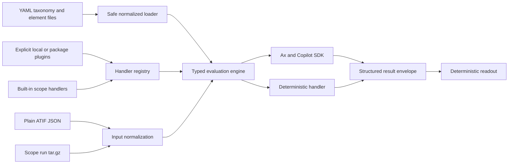

# Taxonome: YAML-driven taxonomy evaluation spike

Taxonome is a **standalone, draft experimental slice**, not the production
Observation model or a dependency on the Experiment stack. It loads authored
taxonomy definitions from YAML, evaluates ATIF v1.7 trajectories, and returns
schema-validated structured observations. The initial slice contains:

- prompt-based Skipped Invocation through Ax and the GitHub Copilot SDK;
- deterministic Timeout through reviewed TypeScript;
- explicit third-party deterministic handler plugins;
- plain ATIF JSON and existing Scope run archive inputs;
- deterministic JSON/Markdown readout previews.

No Scope API, Judge, database, Redis, queue, or token manager is required.
Production adoption, the remaining taxonomy, generated-code execution,
sandboxed plugins, and narrative readout generation remain out of scope.

## Architecture

The same normalized taxonomy, ATIF stream, registry, and result envelope serve
single-element and mixed evaluation:



The `taxonomy-engine` package root does not import Ax or the SDK. Prompt
execution is explicitly provided by `taxonomy-engine/copilot`, so a
deterministic-only process does not initialize the SDK and needs no token.

The shipped taxonomy is the separate `ax-taxonomy` catalog package. It owns
only taxonomy definitions, concrete handlers, focused catalog tests/fixtures,
and minimal asset/registration exports. Timeout lives in
`packages/ax-taxonomy/src/handlers/timeout/handler.ts`, with co-located
`handler.test.ts`. The CLI explicitly composes both packages; the engine never
imports the catalog, so the dependency remains one-way.

## Build and run

From the repository root:

```bash
pnpm install --frozen-lockfile
pnpm --filter taxonomy-engine build
pnpm --filter ax-taxonomy build
pnpm --filter taxonome build
pnpm --silent taxonome run \
  packages/ax-taxonomy/fixtures/timeout.atif.json \
  --taxonomy packages/ax-taxonomy/taxonomy/taxonomy.yaml \
  --elements beh-timeout
```

`run`, `eval`, and `optimize` require `--taxonomy`; there is no automatic
taxonomy discovery. The exact authored schema identifier is
`scope/taxonomy/v1`. The CLI accepts plain ATIF JSON or a Scope run `.tar.gz`
archive and detects archive content by gzip bytes, not filename.

Use `pnpm --silent taxonome ...` for repository development and demos.
`--silent` suppresses the pnpm banner, so stdout remains one valid JSON or
Markdown document. Diagnostics and help go to stderr. Interactive diagnostics
use restrained semantic color; redirected output, CI, `TERM=dumb`, `NO_COLOR`,
and `FORCE_COLOR=0` are plain. Nonzero `FORCE_COLOR` enables diagnostic color.
Machine output is never styled, and meaning never depends on color alone.

Prompt execution requires `COPILOT_GITHUB_TOKEN` in the process environment.
The CLI passes it explicitly as SDK `gitHubToken` with
`useLoggedInUser: false`; there is no `GH_TOKEN` or logged-in-account fallback.
Never put a token in a flag, taxonomy, plugin configuration, or committed file.

## Authored taxonomy contract

A taxonomy may embed element definitions or reference manifest-relative
per-element YAML. Both forms normalize to the same immutable typed structure.
References must remain under the taxonomy root and cannot traverse symlinks.
YAML aliases/anchors, duplicate keys, repeated/cyclic references, unknown
handlers, duplicate element IDs, and unsupported JSON Schema features fail
explicitly.

```yaml
schema_version: scope/taxonomy/v1
id: agent-behavior
version: 2.0.0
categories:
  - id: behavior-category-invocation
    label: Invocation behavior
elements:
  - path: elements/timeout.yaml
```

Element YAML owns metadata, declared surfaces, actual prompt instructions,
implementation selection/configuration, evidence requirements, and output
schema. Deterministic YAML refers to an origin-independent handler ID, never a
module path:

```yaml
schema_version: scope/taxonomy/v1
id: beh-timeout
label: Timeout
category_id: behavior-category-invocation
implementation:
  type: deterministic
  handler: scope/timeout-v1
  config:
    threshold_ms: 1000
evidence:
  complete_for_negative: true
output_schema:
  type: object
  required: [state]
  additionalProperties: false
  properties:
    state:
      enum: [completed, indeterminate, inapplicable, error]
```

The supported authored JSON Schema subset is deliberately non-executable:
`type`, `const`, `enum`, `properties`, `required`,
`additionalProperties`, `items`, `minItems`, `minimum`, and `oneOf`.
`$ref`, recursive schemas, and custom keywords are rejected. Schema depth and
node counts are bounded. The taxonomy digest is a canonical semantic SHA-256,
so formatting and key order do not change it.

## Handler registry and plugins

One registry resolves built-in, local-project, and installed-package handlers.
Built-ins reserve the `scope/` namespace. External plugins must use their own
namespace, such as `acme/retry-loop-v1`; unknown and duplicate IDs fail without
override.

Plugins are loaded only through repeatable `--plugin` flags or an injected
programmatic registry. A plugin exports the exact versioned contract
`scope/taxonome-plugin/v1` and registers deterministic handlers with a config
validator and implementation:

```typescript
import { defineTaxonomePlugin } from "taxonomy-engine/plugins";

export const taxonomePlugin = defineTaxonomePlugin({
  api_version: "scope/taxonome-plugin/v1",
  provider: {
    name: "acme-taxonomy-handlers",
    version: "1.0.0",
  },
  handlers: {
    "acme/retry-loop-v1": retryLoopHandler,
  },
});
```

Relative plugin paths and installed package names resolve from the invocation
working directory, including when Taxonome itself is globally installed.
Dependencies resolve from the plugin location through normal Node module
resolution. Taxonome does not scan directories or `node_modules`, install
packages, perform network lookup, or import a module named by YAML.

Plugin imports and top-level code run with the Taxonome process permissions.
This is **not a sandbox**. Frozen input/config/output validation protects data
contracts and mutation invariants, not the host from malicious plugin code.
Provider origin, version, entry point, and integrity metadata appear in result
provenance but do not change the origin-independent YAML handler ID.

The complete developer example is
[`examples/taxonome-custom-handler`](../../examples/taxonome-custom-handler/README.md).
It builds a local plugin and runs the same taxonomy against plain ATIF and a
Scope archive without publishing an npm package. Its deterministic producer
declares a Zod output schema, infers the `RetryOutput` type, types each
occurrence, and returns `indeterminate` when explicit recovered-retry evidence
lacks required source attribution. A focused test checks representative
producer outputs against both the TypeScript schema and the YAML runtime schema.
The example exposes that offline code test as `pnpm test:handler`; it executes
the TypeScript handler directly and makes no SDK calls.

The same example also contains a custom prompt element and a small disjoint
train/validation/held-out packet. From the example directory, a real
`taxonome` executable can run the prompt, evaluate fixed held-out assertions,
perform one bounded Ax optimization, save the complete v2 artifact, and
re-evaluate through normal artifact restore. The current neutral-control cases
use opaque model-visible session/run/scenario/profile identities, distinct
families and originating runs, separate gold, and no element ID or label in
trajectory text. A regression serializes each case with the production
`taxonomyPromptEvidence()` projection and verifies that case/family/origin
metadata is absent and every forwarded identity is outcome-neutral.
Current user-facing paths name the subject and role explicitly:
`datasets/repeated-request/trajectory-cases.jsonl`,
`datasets/repeated-request/expected-judgments.json`,
`inputs/repeated-request/example-run.atif.json`,
`results/repeated-request/held-out/original-prompt-results.json`,
`artifacts/repeated-request/optimized-prompt.ax.json`, and
`results/repeated-request/held-out/optimized-prompt-results.json`. Historical
evidence files retain their original names and hashes.

The first 11-call YAML prompt demo under `evidence/yaml-prompt-demo/` is retained
as historical execution evidence but is **ID-confounded**: its model-visible
session IDs included descriptive positive/negative hints. Its results are not
treated as a clean prompt-quality control and are not relabeled. The separately
versioned neutral-ID control records new calls and artifacts without changing
the original packet, gold semantics, or frozen 256-call experiment snapshot.

## ATIF and `extra.scope`

The engine receives `{ atif, taxonomy }`, never an opaque archive. Run-specific
facts and evidence live under `extra.scope`; static policies and handler
configuration live in YAML. Plain ATIF defaults to `complete` unless it
explicitly declares `partial` or `unknown`.

The extension version is `scope.atif-extension.v1`:

- trajectory-level state, task, run/scenario/profile identity, available
  sources, configured capabilities, and outcomes;
- step-level source origin and discovery events;
- call-level source, outcome, duration/timestamps, interruption, response, and
  archive origin.

Availability is not discovery, configuration is not invocation, and transcript
prose is not silently promoted to structured evidence. Source IDs, surfaces,
turns, calls, and cross-references are validated before evaluation. Missing or
contradictory evidence produces `indeterminate`, not a fabricated negative.

The historical spike's separate ATIF plus `minimal-context.json` input remains
immutable evidence. `convertLegacyInput` provides an explicit deterministic
conversion for compatibility tests; the normal CLI no longer accepts
`--context` and does not silently reinterpret old artifacts.

## Scope archive ingestion

Taxonome reads the existing Scope export layout:

```text
<request-id>/
  run.yaml
  iteration-1.atif.trajectory.json
  iteration-1.tool-calls.jsonl   # optional matching enrichment
  iteration-2.atif.trajectory.json
```

Extraction is in memory and bounded by compressed bytes, expanded bytes, entry
count, and path depth. Absolute/traversal/backslash paths, links, devices,
FIFOs, duplicate paths, multiple run roots, malformed `run.yaml`, and missing
iteration ATIF fail explicitly. Taxonome never regenerates ATIF from HAR and
never fetches archived artifact URLs.

Every archive iteration becomes one deterministic global ATIF step sequence.
Step IDs are reassigned monotonically. Colliding call IDs receive an
iteration-qualified identity, and observation references are rewritten.
Original iteration/step/call identities remain under
`extra.scope.origin`. Tool-call JSONL may enrich only exact matching ATIF calls;
unmatched records fail.

Archive completeness derives from both terminal run state and artifact
coverage. A `done` run with every declared iteration ATIF is `complete`; other
states are `partial`, and an explicitly partial/unknown constituent trajectory
cannot be upgraded by a terminal run. A terminal run must include `finishedAt`.
Requested skills/MCP/extensions/resources stay in `configured_capabilities`;
only ATIF-declared availability or successful recorded MCP/resource outcomes
enter `available_sources`. This preserves positive, completed-negative, and
unknown distinctions across iterations without treating configuration as use.

## Typed API and result contract

```typescript
import { readFile } from "node:fs/promises";
import {
  evaluate,
  loadTaxonomy,
  parseScopeAtif,
} from "taxonomy-engine";
import {
  createAgentBehaviorHandlerRegistry,
} from "ax-taxonomy";

const handlers = createAgentBehaviorHandlerRegistry();
const taxonomy = await loadTaxonomy("taxonomy.yaml", { handlers });
const atif = parseScopeAtif(JSON.parse(await readFile("run.atif.json", "utf8")));
const results = await evaluate({ atif, taxonomy }, ["beh-timeout"]);
```

Programmatic callers can load plugins into the same registry or directly
register reviewed handlers. Inputs are cloned and frozen before handler
execution; original ATIF order, fields, metrics, timing, and identities are not
mutated.

The result envelope version is `scope/taxonomy-evaluation/v1`. It contains:

- taxonomy schema/id/version/digest;
- element ID/label/category metadata;
- implementation type, origin-independent handler ID, and provider provenance;
- a result validated against the element's authored output schema;
- grounded occurrence references for source/turn/call drill-downs.

Completed absence is `{"state":"completed","observed":false}`. Unknown evidence
is `{"state":"indeterminate","reason":"..."}`. Confidence is intentionally
absent. Invalid or ungrounded output is an explicit error and never triggers a
second model repair call.

## Prompt execution, cases, optimization, and readout

The prompt element's YAML instructions and output schema are wrapped in a
generic immutable trust boundary. Ax performs one typed program step and the
Copilot adapter makes one SDK request per eligible prompt element. There is no
cross-element batching, repair-loop exploration, or inference fallback.
Deterministic elements make zero Ax/SDK calls.

Cases and gold remain separate. Every case records split, family, originating
run, ATIF, and requested elements. Loading rejects family or originating-run
leakage across train, validation, and held-out sets. Fixed assertions validate
state, polarity, cardinality, source, turn, call, and extension-point identity.
An `eval` PASS means the detector output matches the reviewed judgment; an
expected completed `false`, `indeterminate`, or `inapplicable` result can pass.
`passed` / `total` counts case executions, including repeated `--samples`, not
successful agent tasks or model-call count. When a prompt element reaches model
execution, each evaluation makes a fresh SDK call; authoritative preflights can
resolve a case without one. Supplying an artifact restores optimized prompt
components and demos, but never reuses cached answers from an earlier
evaluation.

Optimization artifacts use `scope/taxonome-ax/v2` and bind the complete Ax
serialization, including learned demos, to the exact taxonomy digest, element,
model, prompt contract, and corpus. Historical `taxonome.ax.v1` artifacts fail
clearly instead of being replayed under revised YAML semantics. The real Ax
convenience optimizer remains bounded bootstrap plus GEPA. `maxMetricCalls` is
not an all-in budget; every student, teacher, reflection, retry, and replay SDK
attempt shares the durable cumulative ledger.

The ledger reserves before submission and has an immutable maximum of 500 for
the recorded experiment. Failed and crash-interrupted reservations still
count. Separate processes use exclusive filesystem locking. Keep experiment
ledgers outside the checkout.

`readout <results.json> --taxonomy taxonomy.yaml --markdown preview.md`
optionally verifies the taxonomy digest before producing deterministic JSON
and Markdown. It reports behavior/source frequencies, distinct runs versus
occurrences, total/assessed/unknown/excluded/error coverage, and stable evidence
drill-downs. It does not scrape prose, re-infer omitted findings, make another
model call, or replace production readout.

## Compatibility boundary

The YAML/archive/plugin revision preserves the complete historical v1 evidence
directory and its 256-call ledger byte-for-byte. Historical output remains
accurately labeled for its original contracts and source commits. New inputs,
results, and optimization artifacts are versioned separately. Compatibility is
explicit conversion or rejection; there is no silent reinterpretation.

The current private package boundary is intentionally explicit:

- `taxonomy-engine` owns loading, normalization, execution, case/gold
  assertions, prompt/SDK plumbing, optimization/artifact compatibility,
  deterministic readout, archive conversion, and generic neutral tests.
- `ax-taxonomy` owns only the shipped `agent-behavior` YAML, catalog fixtures,
  `scope/timeout-v1`, focused definition/handler tests, and minimal
  asset/handler registration exports.
- `taxonome` depends on both and explicitly registers `ax-taxonomy` before
  loading trusted third-party plugins.

The earlier experimental package name `taxonomy-evaluation` was renamed to
`taxonomy-engine`. Current callers import generic APIs from `taxonomy-engine`,
and catalog APIs such as `createAgentBehaviorHandlerRegistry()` or
`loadAgentBehaviorTaxonomy()` from `ax-taxonomy`. The old
`createBuiltInHandlerRegistry()` convenience and unused hard-coded legacy
catalog facades were retired rather than preserved through a dependency cycle
or hidden fallback. Frozen evidence still records the source paths and API
surface that were true at its historical commits.

Both packages have package-local Vitest configuration:

```bash
cd packages/taxonomy-engine && pnpm test
cd packages/ax-taxonomy && pnpm test
```

The engine command runs only generic neutral-fixture tests; the catalog command
runs only focused agent-behavior definition and Timeout tests. Neither command
requires model credentials or scans the rest of the monorepo.

## Recorded spike findings (2026-10-21)

**Recommendation: retain the simplified structured occurrence model for the
next review, and prefer the revised baseline prompt over the learned-demo
artifact for this packet.** This is not a production-model decision or phase
exit. A run-level Boolean cannot preserve the tested behavior/source frequency
and per-call drilldowns; adding confidence or repeated category metadata did
not solve a concrete consumer need.

All raw evidence is in
[`packages/taxonomy-engine/evidence/`](../../packages/taxonomy-engine/evidence/).
`manifest.json` records hashes, settings, per-phase usage, and the full
cumulative ledger. Model evals are distinct from the offline tests.

After the experiment was frozen, the implementation received a
behavior-preserving readability pass under the repository's code-readability
guidance. It renamed local variables, separated logical phases, documented
public and non-obvious contracts, and simplified control flow without changing
prompt text, schemas, fixtures, gold facts, recorded outputs, or the 256-call
ledger. Local commit `23c27e3b18a506cf639e54aa668387fea9993536`
contains that source-only revision, based on evidence source commit
`7d217d727ac0adaa4cc4121767316fab62d09f3c` and readability guidance commit
`05bd8b7e`. The manifest preserves both source fingerprint sets and records zero
additional model calls; no model evidence was regenerated.

A later local comment-coverage pass at
`c27c5a1b3067db44f4f70927b0ef85e42a9f0516` strengthened the repository rule
and audited every Taxonome runtime, CLI, test, and standalone-adapter
TypeScript file. Each non-trivial function and logical phase now includes a
short explanation of what it does, while trivial/self-evident code remains
unnarrated. The manifest records hashes for all 26 audited files, zero model
calls, and unchanged prompt/contracts/fixtures/gold/outputs/ledger.

Local commit `2cd0234d06d35595ed489aab6f5dddb9d601cd37` adds semantic
JSDoc/TSDoc for function parameters, options, types, and fields/properties
across the same spike surface. The comments cover meaning, constraints, units,
optionality, and defaults without adding runtime schema descriptions. It also
adds the root `CLAUDE.md` loader (`@AGENTS.md`) and keeps its only rule loader
specific: all project instructions belong in `AGENTS.md`. The manifest records
all 27 guidance/loader/TypeScript hashes, zero model calls, and unchanged frozen
evidence.

The local stack-integration merge
`8dda331288926cb87e7d3323653a085bc69fd20a` has parents
`f78af8d4a602339de41ade6d689fc8779e0dfab8` (published spike) and
`6ae17ce30247bb893ab85af170c4c5e290228dd5` (prepared PR 1517 parent).
It preserves both histories without rebasing. The generic Code Readability
section and exact `CLAUDE.md` loader are inherited from the lower guidance
layer; the only parent-relative `AGENTS.md` change is the Taxonome
documentation-table row. The two merge conflicts were additive static-prompt
inventory/coverage updates: 19 Experiment-stack quality targets plus the
standalone Taxonome SDK target. No Experiment/API/Portal/Judge/scheduler/readout
implementation file appears in the Taxonome parent-relative diff. The manifest
records the integration/current-source hashes separately; frozen model evidence
was not rerun or rewritten.

Local commit `94305d5ac8eb3b9387770d4964b9653fa632f019`
adds the polished demo-facing CLI without adding a dependency. It reuses the
Scope CLI's Node `util.styleText` and Commander help-styling pattern, adds
concise command descriptions, and restricts semantic color to interactive
stderr/help/progress. `NO_COLOR`, `FORCE_COLOR`, CI, dumb terminals, TTY versus
pipe behavior, accessible PASS/FAIL/error text, and ANSI-free JSON stdout are
covered offline. The documented/demo command is now
`pnpm --silent taxonome ...`, which suppresses pnpm's banner while preserving
Taxonome diagnostics. The manifest records this source-only revision and zero
additional model calls separately from the frozen experiment.

| Experiment | Case result | Actual SDK requests | Interpretation |
|---|---:|---:|---|
| Original neutral-ID baseline, 18 cases twice | 33/36 | 36 | Two relevance/inapplicability confusions and one false certainty with unknown completeness |
| Original complete-artifact replay | 35/36 | 36 | Unknown-completeness mistake remained; preserved, not relabeled |
| Revised baseline, same regression packet twice | 36/36 | 30 | Six known metadata preflights; eight additional deterministic Timeout assertions also passed |
| Revised complete-artifact regression replay | 36/36 | 30 | Same assertions and preflight rules, no accuracy gain |
| Fresh final packet baseline, 6 cases twice | 12/12 | 10 | Two preflights plus two additional deterministic Timeout assertions |
| Fresh final packet complete-artifact replay | 12/12 | 10 | Candidate was fixed before either final comparison; no subsequent tuning |
| Actual opaque-ID renaming replay | 3/3 | 3 | Same gold source/turn facts after run/session ID changes |

The first packet became development/regression evidence once its validation
failures informed the wrapper/precondition revision. The separate final
packet was frozen at `dd19789a92f18254842ff1cafe3c912b563ce9ac`, is disjoint by
family/origin, and was never supplied to the optimizer. Six-row/two-repeat
synthetic results are functional evidence, not a statistical production
accuracy estimate. One negative format case reconstructs a reviewed repository
HAR fixture; these results do not establish broad real-run generalization.

The correction was **not an optimizer-only accuracy claim**: authoritative
completeness/exclusion belongs in the shared runtime. Eligible complete-run
prompts still decide task relevance/discovery/non-use. An irrelevant reference
is a completed negative, not an excluded assessment. No semantic gold facts
were weakened. Earlier contract artifacts remain archived; the current loader
deliberately rejects their old contract hash.

### What the real Ax experiment established

The pinned convenience API actually runs BootstrapFewShot followed by GEPA.
Both experiments used `maxMetricCalls: 48`, with one cumulative 500-call guard
covering student, bootstrap-teacher, reflection/proposal, and replay requests.
The first optimization used **50** real requests; the revised one used **49**
(44 student, 5 teacher), while its metric trace contains 47 entries.
This demonstrates why a metric budget is not an all-in call budget.

The revised selected artifact contains unchanged task-description/instruction
components, **three learned traces from two distinct training inputs**, and
five labeled training examples. All components, repeated traces, statistics,
and supervised examples are preserved exactly, then restored with
`applyOptimization` through the normal CLI. Repetition in Ax's cumulative
trace collection is not silently deduplicated. No validation/final examples
became demonstrations. With learned demos present, the pinned Ax replay renders
those three traces; the five supervised seeds remain serialized provenance,
not five additional replay demonstrations.
Ax's serialized `totalRounds: 30` is library metadata,
not evidence of 30 paid proposals; actual requests and metric traces are the
authoritative experiment record.

On the fresh final packet, mean input tokens/request rose from **691.8** to
**1790.8** with demonstrations, with no observed accuracy improvement. SDK
round-trip median was 1615ms baseline versus 1096ms replay in these sequential
samples. This was not a controlled cache/latency experiment; do not infer a
throughput advantage or causal speedup.

### Readout fitness and budget

The generated [`readout-preview.md`](../../packages/taxonomy-engine/evidence/readout-preview.md)
uses an actual restored mixed result plus a separate deterministic run, with
explicit matching scenario/profile context. Timeout occurs in **2 distinct
runs / 4 occurrences**. `account/query` contributes **2 runs / 3 occurrences**,
not 3 runs; `authctl` contributes 1 run / 1 occurrence. The unexecuted Skipped
Invocation assessment in the second run is counted unknown/missing, not
negative. JSON and Markdown come from the same deterministic consumer, without
another inference call or prose scraping.

The frozen all-in ledger ends at **256/500 requests** with 244 unused slots,
256 completion records, one observed model attempt per request, and usage
available for every request. Totals: **369886 input tokens**, **12161 output
tokens**, and an SDK cost-multiplier sum of 256. Dollar cost is unknown, not
zero. The two early proof calls (including the coordinator's) are included.
There are no unresolved reservations or observed transport failures; preserved
functional model mistakes are shown separately above. Tuning stopped because
the required technical evidence was complete, not because the budget ran out.

### Reproduce the review

Offline verification (no credentials/inference):

```bash
pnpm --filter taxonomy-engine build
pnpm --filter ax-taxonomy build
pnpm --filter taxonome build
(
  cd packages/taxonomy-engine
  pnpm test
)
(
  cd packages/ax-taxonomy
  pnpm test
)
pnpm exec vitest run \
  packages/taxonomy-engine/src \
  packages/ax-taxonomy/src \
  apps/taxonome/src --reporter=default
pnpm --filter static-prompt-evals exec vitest run --config adapter/vitest.config.ts --reporter=default
pnpm --silent taxonome readout \
  packages/taxonomy-engine/evidence/readout-input.json \
  --markdown /tmp/taxonome-preview.md
```

Recorded current verification: package-local `taxonomy-engine` **44 tests / 13
files**, package-local `ax-taxonomy` **18 tests / 2 files**, combined
engine/catalog/CLI **76 tests / 18 files**, example deterministic handler **2
tests / 1 file**, and static-eval TypeScript **38 tests / 7 files**. Builds,
type checks, static-eval Python tests, manifest coverage, license headers, and
regenerated notice checks also passed. Package-local commands use source
conditions and still pass with both package `dist/` directories absent.

For a separately authorized live review, use the earlier `eval` commands
with `fixtures/final-inputs.jsonl`, `fixtures/final-gold.json`, and
`evidence/optimized.v2.ax.json`, an explicit token, and an external review
ledger. Do not modify the committed evidence ledger or treat a new file as
permission to reset the overnight budget.

## Production impact and limits

These packages are not wired into Judge, API, Portal, or post-processing. If a
later accepted design adopts these findings, #1206 would need an explicit
occurrence-capable result union rather than one Boolean/criterion row per
run. Judge would host the core without changing its DAG/attempt protection;
persistence/export/UI would need conditional unassessed states, multiple
typed-source occurrences, stable ATIF references, schema versions and
compatibility for historical results. Readout consumers would derive category
and grouping metadata, never scrape prose or infer omitted findings.

Native Ax Flex-style executable-code optimization is not assumed. The required
Timeout implementation is reviewed TypeScript. No generated code is executed:
there is no approved credential-free/network-free isolated runner in this
spike, and `node:vm` is not one. Optional code optimization is not a gate.
