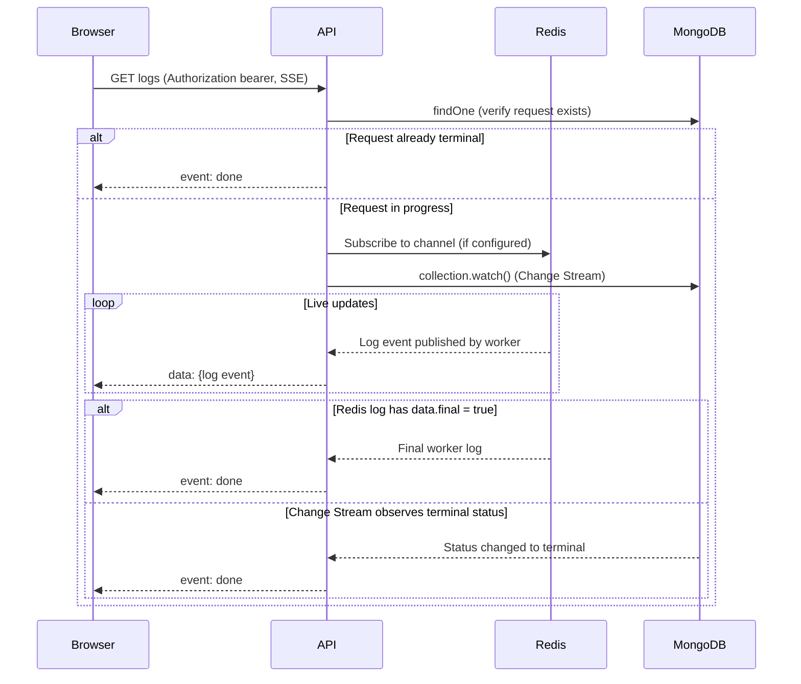

# Real-Time Data Flow: SSE, Change Streams & Polling

## Overview

The portal uses **two mechanisms** for real-time updates:

1. **SSE + MongoDB Change Streams** (+ optional Redis pub/sub) — for live log streaming on the run detail page
2. **React Query `refetchInterval` polling** — for periodic list/dashboard refreshes

## SSE Endpoint

```
GET /api/v1/requests/:id/logs?fromStart=true
GET /api/v1/requests/:id/runs/:runId/logs?fromStart=true
GET /api/v1/reports/:id/logs?fromStart=true
```

Defined in `apps/api/src/routes/requests/logs.ts` and `routes/reports.ts`.
`fromStart=true` replays append-blob logs before switching to live streaming;
terminal runs/reports replay and then send `done`. Historical attempts use the
per-run URL. These endpoints use the same verified bearer and canonical
project authorization as other protected reads.

### Server-Side Flow



### Key Behaviors

- **SSE heartbeat** every 30s (`:\n\n` comment) to prevent proxy/LB disconnects
- **Inactivity timeout** of 5 minutes — closes stream if no log messages forwarded
- **Redis pub/sub** is the primary log transport (`logs:<requestId>`); a worker
  log with `data.final === true` also sends `done` and closes the stream.
- **MongoDB Change Stream** is a **completion detector only** — watches for run status `done` or report status `completed`/`failed`
- **Authorization lease** rechecks canonical authority every second and closes a
  denied/unverifiable stream; its deadline is at most 20 seconds and cannot
  outlive the verified token. A late authority response cannot revive it.
- Cleanup on client disconnect (`req.on("close")`)

### Portal Consumer

`useLogStream` in `apps/portal/src/hooks/use-log-stream.ts` opens a streaming
response through the existing `apiClient`, not native `EventSource`. The same
MSAL token provider attaches the bearer header, combines the account-session
abort signal, and performs one forced-refresh retry on `401`. Tokens are never
added to stream URLs. HTTP success, SSE content type and response body are checked
before reporting a connection.
The hook waits for a selected project and sends its explicit `projectId`, so a
still-rendering previous resource cannot reopen under a different selection.

`lib/log-stream.ts` incrementally decodes UTF-8 and uses `eventsource-parser` for
SSE framing (split chunks, CR/LF/CRLF, multiline data and comment heartbeats).
Log entries are type-checked; the known `turns_summary` payload is ignored.
Named `done`, `timeout` and server `error` events terminate the reader; malformed
log/error payloads and HTTP/network failures surface separately. This is shared by
current/historical `RunDetail`, stored-report `ReportDetail` and `LogViewer`.

Only establishment failures may retry: at most two retries for network failures,
`429` and transient `500`/`502`/`503`/`504`, with exponential jittered backoff.
`Retry-After` seconds or HTTP dates take precedence; waits over 30 seconds stop
instead of retrying early. Every attempt reacquires its bearer. Other HTTP
statuses do not enter that transient retry loop; `401` remains owned by the
common transport.

There are **no SSE event IDs or supported resume cursors**. Once a stream is
accepted, EOF (including lease expiry/revocation/authority outage) or network
failure disconnects with an explicit error; it never silently reconnects and
duplicates replay or drops live logs. Reload the page to deliberately replay
stored logs. Server `done`/`timeout`/`error` events never reconnect.

Changing the request, attempt, URL builder, selected project or authenticated
account/Scope user cancels the fetch/reader and resets state. Disabling the hook,
logout and unmount also cancel it. A render-time identity guard hides previous
project/account logs before effect cleanup, and late replaced-reader callbacks
cannot append them to the new stream. `clear` clears displayed logs only.

## Authenticated artifact delivery

Portal archive, snapshot, HAR, ATIF, tool-call and codebase-revision downloads
use `lib/artifact-delivery.ts` through the same bearer transport. Its URL
allowlist accepts only same-origin Scope artifact routes and fixed selectors,
adds the selected project explicitly and rejects foreign origins and redirects.
Downloads retain the existing complete-file buffering behavior, sanitize
filenames and release their temporary object URLs on cancellation, page exit
or expiry. Batch archive POSTs are not retried after network/5xx failures.
HTTP failures are displayed rather than saved as successful artifact files.
GET establishment retries recognize ky's wrapped network errors, not arbitrary
`TypeError`s. An accepted response body's failures never replay the transfer.

`useArtifactSession` binds operations to the account-session abort signal,
Scope user, project and selected resource/attempt. It cancels on identity
replacement, logout, navigation or unmount. HAR/tool-call query keys include
that identity, and disabled/not-ready sessions cannot publish stale data.
`RunDetail` pins every available artifact to the resolved attempt, including
the current attempt; missing/loading/failed historical selections never
substitute the latest attempt. Batch downloads deliberately select latest
attempts at the server.

Recordings use a client-bound service-worker bridge instead of whole-video
buffering. See [Authenticated progressive recordings](../architecture/authenticated-media.md)
for range semantics, lifecycle, browser requirements and acceptance limits.

## Append-Blob Artifacts

A few per-run artifacts follow the same append-only JSONL pattern as logs and are
read lazily by clients (no SSE stream — fetched on demand by ID/iteration):

| Artifact | Container | Path | Producer | Consumer |
|----------|-----------|------|----------|----------|
| Log events | `logs` | `{requestId}/runs/{runId}/run.jsonl` | `BlobStorage.appendLogEvent` (workers) | SSE replay + `GET /api/v1/requests/:id/logs` |
| Per-iteration tool calls | `snapshots` | `{requestId}/runs/{runId}/iteration-{n}/tool-calls.jsonl` | `BlobStorage.writeToolCalls` (`multi-turn-loop`) | `GET /api/v1/requests/:id/tool-calls?iteration=N`, consumed by `useAllTurnsToolCalls` |

Tool-call JSONL was introduced (#812) to keep unbounded per-iteration tool-call
lists out of the `RequestDocument` (CosmosDB document size is capped at 2 MB).
The turn carries only `toolCallsUrl` + `toolCallCount`; legacy turns with an
inline `toolCalls[]` array remain readable for backwards compatibility.

## React Query Polling

[TanStack Query](https://tanstack.com/query) (formerly React Query) provides client-side polling via `refetchInterval`:

| Page | Interval | Behavior |
|------|----------|----------|
| `RunsList.tsx` | 10s | Always polls |
| `RunDetail.tsx` | Conditional | Stops polling once run reaches terminal state |
| `Insights.tsx` | 30s | Always polls |

React Query also provides:
- **Stale-while-revalidate** — returns cached data immediately, refetches in background
- **Window focus refetch** — refetches when browser tab regains focus
- **Cache with GC** — unused query data garbage-collected after 5 minutes

## CosmosDB Compatibility

The Change Stream in the API uses:

```typescript
collection.watch(
  [{ $match: { "documentKey._id": id, operationType: "update" } }],
  { fullDocument: "updateLookup" }
);
```

### Support by Product

| Product | Change Streams | `operationType` in output | Code works correctly? |
|---------|---------------|--------------------------|----------------------|
| **Native MongoDB** | Full support | Yes | Yes |
| **CosmosDB RU-based** (3.6+) | Supported with limits | **Not returned** | May not filter correctly |
| **Azure DocumentDB vCore** (5.0+) | Full compat (~99%) | Yes | Yes |

### CosmosDB RU-Based Limitations

Per [Microsoft docs](https://learn.microsoft.com/en-us/azure/cosmos-db/mongodb/change-streams):

- `operationType` and `updateDescription` are **not returned** in the output document
- Only `insert`, `update`, `replace` events — **no delete events**
- `$match`, `$project`, and `fullDocument` are **required**
- No Change Feed Processor library or Azure Functions triggers

The `$match` filter on `operationType: "update"` may silently fail on RU-based CosmosDB. The code handles this defensively:

- Entire Change Stream setup wrapped in try/catch
- Errors on the stream are caught without crashing
- The 5-minute inactivity timeout acts as the ultimate safety net

### Recommendation

If running on CosmosDB RU-based, ensure Redis is configured as the primary log transport. The Change Stream should be treated as best-effort for completion detection, not as a reliable event source.
