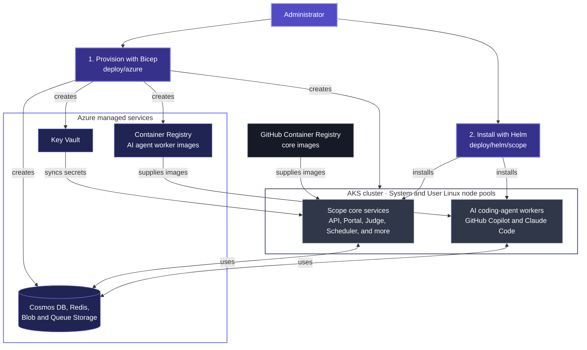

Scope can be self-hosted on Kubernetes with the
[`deploy/helm/scope`](/self-hosting/deploy-helm/)
chart. Infrastructure provisioning is separate from application deployment
and can vary by cloud or Kubernetes provider.

This documentation currently provides Azure Kubernetes Service (AKS) as one
infrastructure option. Additional provider-specific provisioning guides can
be added alongside it in the future. The deployment flow is:

1. Provision a Kubernetes cluster and its required data, secret, identity,
   and image-registry services. For the Azure option, follow
   [Provision Azure infrastructure](/self-hosting/provision-aks/).
2. Install the six core services by following
   [Deploy with Helm](/self-hosting/deploy-helm/).
3. Configure the coding-agent workers. For the Azure quickstart, follow
   [Enable coding-agent workers](/self-hosting/deploy-helm/#phase-3-enable-coding-agent-workers).

The Azure option uses a resource-group-scoped open-source template from
[`deploy/azure`](https://github.com/microsoft/scope/tree/main/deploy/azure).
It is separate from the repository's internal development infrastructure.

## Azure reference architecture

For the Azure option, the infrastructure template creates the network, AKS
cluster, managed data services, container registry, and workload identities.
[Helm](https://helm.sh/docs/) installs the application into the `scope`
namespace.

The public Azure quickstart has one fixed-size System node pool and one
fixed-size User Linux node pool. OIDC and workload identity are enabled. The
native Azure Key Vault Secrets Provider add-on syncs selected Key Vault
objects into one Kubernetes Secret.

The core images come from `ghcr.io/microsoft`. The API builder-stage image
runs database migrations. The ACP worker images are built in the provisioned
ACR because they are enabled separately after the core install.

## Installed workloads

| Workload | Chart resource | Purpose |
| --- | --- | --- |
| API | Deployment and `api` Service | REST API and orchestration |
| Portal | Deployment and `scope-portal` Service | Web interface |
| Judge | Deployment and Service | Criteria evaluation |
| Token Manager | Deployment and Service | Provider credential management |
| Scheduler | Deployment and Service | Request scheduling |
| Report Generator | Deployment | Background report generation |
| Database migration | Post-install/post-upgrade Job | Applies MongoDB migrations |
| Copilot worker | Optional Deployment | GitHub Copilot through ACP |
| Claude Code worker | Optional Deployment | Claude Code through ACP |

Each coding-agent worker can run an MCPJungle native sidecar for MCP server
aggregation. The chart does not yet template the AI Gateway/DevProxy sidecar
or Kubedock, so scenarios that require HAR capture or in-task Docker access
are not supported by this deployment.

The chart also does not install an ingress controller, DNS, TLS,
cert-manager, autoscaling, or an observability stack.

Scope's production/reference architecture adds queue-driven AI coding-agent
worker and node-pool scaling beyond this quickstart. See
[Autoscaling with KEDA](/self-hosting/scaling/) for how KEDA, the Kubernetes
scheduler, and the cluster autoscaler work together.

## Azure identity boundary

The Azure deployment creates two federated user-assigned identities:

- The backend identity can access Key Vault, Redis, Blob Storage, and queues.
- The worker identity can access Blob Storage and queues only. It has no Key
  Vault role because worker pods execute benchmark-controlled agent code.

Worker credentials should be registered through the Portal's **Secrets** tab
or the Token Manager API. Static Key Vault objects are available only as a
fallback.

## Prerequisites

- `kubectl`, Helm, `jq`, and access to the repository checkout.
- Provider credentials for the coding agents and models you enable.

The Azure infrastructure option also requires:

- An Azure subscription and permission to create resources and role
  assignments in a resource group.
- Azure CLI with Bicep when deploying from the command line.

To use the currently documented Azure option, continue with
[Provision Azure infrastructure](/self-hosting/provision-aks/), then
[Deploy with Helm](/self-hosting/deploy-helm/).
